本文整理十二个神经网络的一般原理、Qlib v0.9.7实现和本项目的实际适配。每个模型附一张架构图，标明输入维度、主要模块、输出层与年度微调范围。

[下载含架构图的完整Word文档](/downloads/alpha158-20261125/twelve-models-qlib-architectures.docx) · [阅读十二模型回测结果](/posts/alpha158-twelve-models-results/)

表格可左右滑动查看完整列，架构图可点击放大。

**实验版本**：本文及配套结果对应2026年11月25日归档的十二模型实验：首年全参数训练，后续年度继承同种子模型并只微调预测头。这里记录实际完成的这批实验，不代表每年从头重训的对照结果；LightGBM不在这十二个神经网络中。

> 本轮Alpha158实验的模型学习与实现对照

原文版本 2026年11月24日    架构图增补 2026年11月25日    Qlib v0.9.7

这12个模型覆盖表格学习、循环网络、卷积、注意力、股票关系和多专家等不同建模思路。它们在本轮实验中使用同一套Alpha158特征与评价规则，用于比较不同结构在股票收益预测中的表现。

阅读时需要分清三个层次：模型的一般原理、Qlib提供的具体实现，以及本项目采用的训练和适配方式。相同名称不代表代码、目标函数、数据窗口和交易策略完全相同。尤其是TRA和TFT，本轮存在明确的实现适配。

### 模型分类总览

| 模型 | 主要学习对象 | 显式回看 |
| --- | --- | --- |
| MLP | 表格网络 | 1个交易日 |
| LSTM | 循环时序网络 | 20个交易日 |
| GRU | 循环时序网络 | 20个交易日 |
| ALSTM | 循环网络加注意力 | 20个交易日 |
| GATs | 股票关系网络 | 20个交易日 |
| TCN | 卷积时序网络 | 20个交易日 |
| Transformer | 自注意力时序网络 | 20个交易日 |
| Localformer | 局部卷积加注意力 | 20个交易日 |
| TRA | 多专家与路由模型 | 60个交易日 |
| TFT | 融合型时序网络 | 6个交易日 |
| TabNet | 表格网络 | 1个交易日 |
| SFM | 频率记忆时序网络 | 20个交易日 |

表中的回看长度属于本轮设置，不是模型固有上限。全部模型每个时间点均保留158项特征，包含VWAP0。MLP和TabNet虽然只输入当天特征，但Alpha158本身已包含历史滚动统计。

阅读顺序：先了解Qlib工作流，再逐项对照12个模型的架构图与实现说明，随后查看实验口径及调用入口；文末提供官方源码与本项目实现依据。

**架构图读法：**灰色为数据或无参数操作；蓝色为特征提取部分；橙色为预测头。颜色对应本文这轮实验的冻结边界：首年训练全部参数，后续年度只微调橙色部分。B为批量大小，Nₜ为同日股票数，张量统一按“批量、时间、特征”标注，内部换轴另示。

## Qlib如何组织这些模型

Qlib是量化研究平台，模型库是其中一部分。它把数据加工、模型训练、预测记录和组合评价分开，使同一套数据能够交给不同模型。模型输出通常是每个日期、每只股票的预测分数，分数对应什么收益目标，由标签定义决定。[Q1][Q2]

### 从特征到组合的四个环节

数据处理。Alpha158是特征与标签处理入口。需要拟合的标准化等处理有自己的拟合区间，不能把验证集和测试集混入；历史窗口也必须只包含预测时点已经可见的数据。

数据集切分。DatasetH组织训练、验证和测试段；TSDatasetH等时序数据集进一步形成按股票排列的历史窗口。样本的一天可以是一行158维向量，也可以是由多天向量组成的矩阵。

模型训练与评分。标准封装通常实现fit和predict接口。神经网络本身完成前向计算，训练封装负责批次、优化器、早停和保存参数。Qlib还提供ModelFT接口，但不能因此推断每个模型都自动支持同一种连续微调。

记录与回测。预测分数进入信号记录和选股策略，交易费用及约束由回测配置决定。同一个模型换用不同调仓频率、费用或股票池，净值就可能明显变化。

### 如何理解Qlib的调用入口

例如，GRU的标准配置通过class指定封装类，通过module_path定位模块。下面仅演示模型定位，不包含完整数据、年度继承或本轮回测配置。[Q1][Q3]

```yaml
model:
  class: GRU
  module_path: qlib.contrib.model.pytorch_gru_ts
  kwargs:
    d_feat: 158
    hidden_size: 64
    num_layers: 2
```

本轮复用Qlib的网络组件，通过本项目统一训练器实施年度连续微调与评价。没有直接照搬每个官方示例的完整训练封装，因此也没有自动继承其默认选轮指标、标签、股票池或交易规则。[L1][L2]

## MLP 多层感知机

Multilayer Perceptron

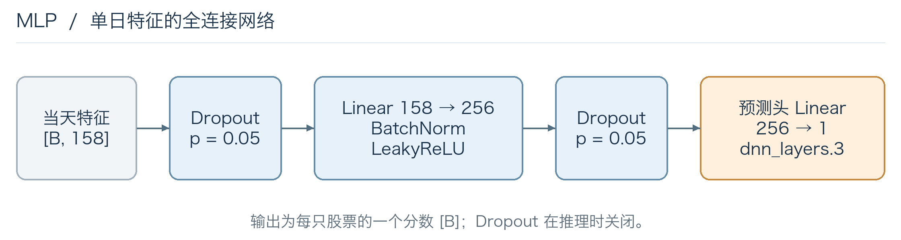

图1  MLP的本轮前向结构。输入保留完整158项特征，输出一个股票评分。[M1][L1]

MLP把当天的一组特征同时送入全连接网络，通过非线性变换学习特征组合。例如，波动率与动量的共同变化，可能比单个因子更有预测力。它没有显式的循环记忆或时间注意力，因此适合检验当天Alpha158特征本身能提供多少信息。

Qlib提供DNNModelPytorch作为训练与预测封装，内部默认网络是Net。Net可配置隐藏层；我们使用的默认结构包含256维隐藏层、批归一化、LeakyReLU及Dropout，最后输出一个分数。原始Alpha158示例会删除VWAP0并使用157维输入，这属于示例配置，不是MLP的结构限制。[M1][Q4]

本轮输入是当天完整158维Alpha158，保留VWAP0；显式回看长度为1。输出层为dnn_layers.3。首年训练全部参数，此后冻结隐藏层和归一化状态，只调整最后的线性层。[L1][L2]

回看长度为1并不意味着模型完全没有历史信息：Alpha158中的动量、均线和波动等特征已经包含历史统计。它与序列模型的区别，是没有把多天特征矩阵作为显式输入。

## LSTM 长短期记忆网络

Long Short Term Memory

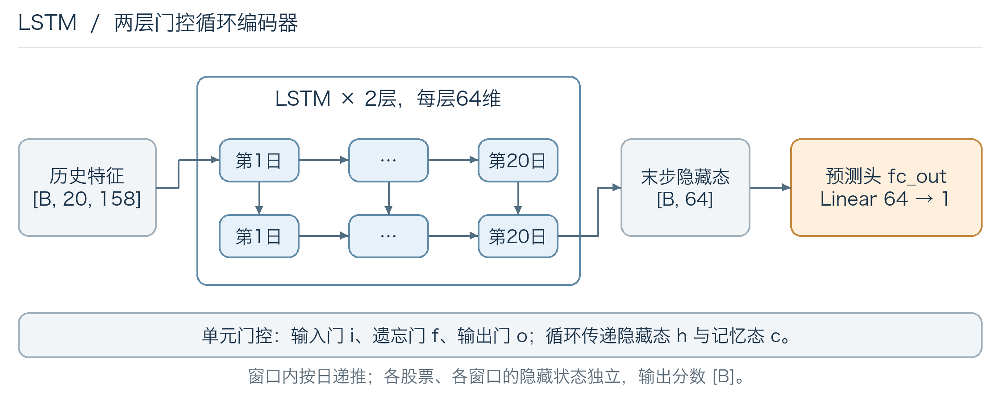

图2  LSTM的两层时序结构。每层按20日窗口递推，最终读取末日隐藏态。[M2][L1]

LSTM按时间顺序阅读一只股票的历史特征。输入门、遗忘门和输出门控制信息写入、保留与读出，内部记忆状态用于保存跨时间的线索。它可以学习趋势形成、成交变化与价格反应之间的先后关系。

Qlib的LSTM封装负责取数据、训练和预测，LSTMModel负责神经网络前向计算。时序版本接收按股票组织的历史窗口，使用最后一个时间步的隐藏表示，经线性输出层生成分数。[M2]

本轮使用过去20个交易日的158维特征，隐藏维度64、2层循环网络、Dropout为0。年度微调只更新fc_out；上一年模型权重继续继承，同一种子保持一条独立路径。[L1][L2]

循环网络的容量和回看窗口都会影响结果。这里继承的是网络权重，不是把不同股票的隐藏状态拼接起来，也不是把整段2013年至2026年的数据当作一条无限长序列。

## GRU 门控循环单元

Gated Recurrent Unit

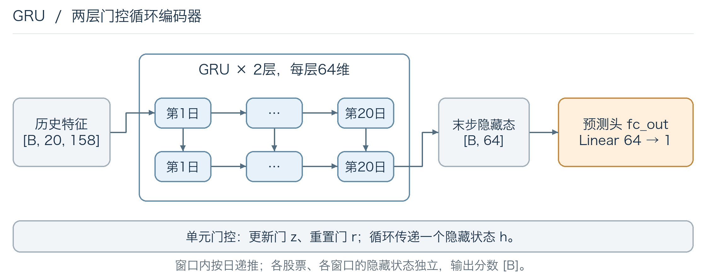

图3  GRU的两层时序结构。更新门与重置门控制历史信息保留和候选状态构造。[M3][L1]

GRU也逐日处理历史窗口，通过更新门和重置门调节旧信息与新信息的结合。相较于同宽度的LSTM，它的门控结构更简洁，适合作为时序模型的基础对照。简洁不代表预测效果必然更好，仍需使用同一评价口径比较。

Qlib提供GRU训练封装与内部GRUModel网络。其时序实现把历史窗口交给循环层，再取最后一个时间步的隐藏向量，通过fc_out输出股票分数。[M3]

本轮回看20个交易日，每天158个特征，隐藏维度64、2层、Dropout为0。初始学习率为0.0002，后续年度微调使用0.00002，保持特征提取部分不变。[L1][L2]

LSTM与GRU的比较应同时查看RankIC、扣费收益和种子波动。单次训练的最好成绩不能充分说明一种门控结构优于另一种。

## ALSTM 带时间注意力的循环网络

Attention based LSTM

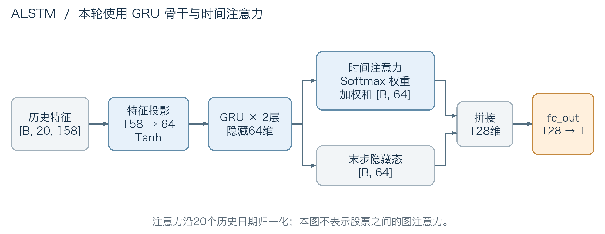

图4  ALSTM实际采用GRU；历史注意力汇总与末日状态拼接，再进行评分。[M4][L1]

ALSTM在循环网络的每个时间步上计算注意力权重，把较相关的历史状态加权汇总，再与最近状态组合。例如，模型可以对某次放量或反转发生的日期给予更高权重，而不只依赖最后一天的隐藏状态。

需要特别注意名称与代码的区别：Qlib的内部ALSTMModel可通过rnn_type选择循环层，v0.9.7默认是GRU。它使用时间注意力汇总历史状态，再与末端状态拼接后预测，因此不应仅凭ALSTM名称断言底层一定是LSTM。[M4]

本轮明确使用GRU作为底层循环单元，回看20日、158维输入、隐藏维度64、2层。fc_out接收两部分组合表示，是后续年度唯一调整的预测层。[L1][L2]

这里的注意力主要回答历史哪些日期更相关，并不等于股票之间的关系建模，也不能直接解释成某个因子的因果贡献。

## GATs 图注意力网络

Graph Attention Networks

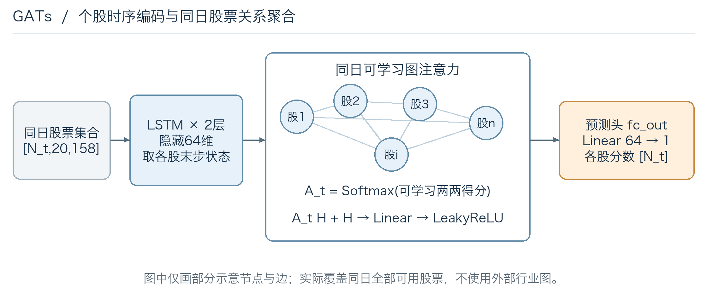

图5  GATs对同日股票构图，先进行时间编码，再做注意力聚合与残差读出。[M5][L1][L2]

GATs同时考虑个股历史与同日其他股票的信息。先为每只股票生成时间表示，再学习股票之间的注意力权重并汇总邻近表示。它尝试捕捉跨股票共同变化，而不仅是各只股票自己的时间规律。

Qlib的GATModel可用LSTM或GRU编码历史，再对同日股票表示计算注意力。该实现中的股票关系由特征学习得到；不能自动把它解释为行业图、供应链图或真实经济联系。其数据采样要求同日股票成组。[M5]

本轮使用2层LSTM编码器，隐藏维度64、Dropout为0.7，回看20日且保留158维。注意力计算使用节省中间显存的等价写法；每次图计算覆盖同日可用股票，不把不同日期混成一张图。初始编码器从头训练，不载入外部LSTM旧权重。[L1][L2]

股票池变化会改变图中的节点与聚合结果。后续年度只微调fc_out，循环编码器与图注意力参数都保持冻结，因此只能调整已有关系表示的读出。

## TCN 时间卷积网络

Temporal Convolutional Network

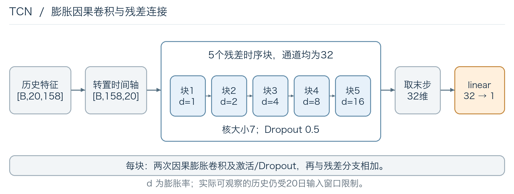

图6  TCN按特征通道排列输入；每个残差块内部包含两次因果膨胀卷积。[M6][L1]

TCN使用沿时间轴的卷积提取局部模式。因果卷积限制信息来自当前与过去，膨胀卷积扩大可覆盖的历史范围，残差连接帮助更深的网络训练。它能识别连续数日的形态组合，且卷积计算易于并行。[P1]

Qlib的时序版本使用TCN封装与内部TCNModel，并调用TemporalConvNet。卷积网络按特征通道和时间组织输入，最终通过线性层生成一个预测分数。[M6]

本轮回看20日、每天158维，5层通道配置均为32，卷积核大小7，Dropout为0.5。统一输入进入适配器后变成批次乘特征乘时间的排列，保证训练和预测的轴顺序一致。[L1][L2]

理论感受野可以大于实际输入窗口，但模型实际可观察的历史仍由20日窗口限制。年度微调更新linear，卷积滤波器不重新学习新的形态。

## Transformer 基于自注意力的时序编码器

Transformer

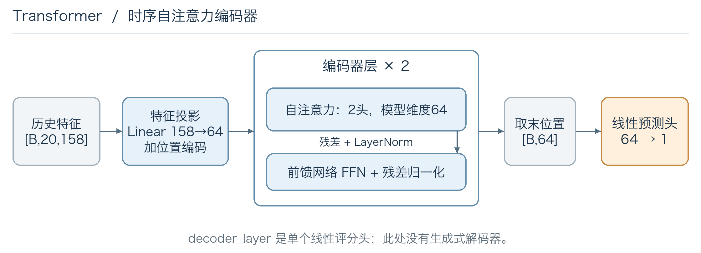

图7  Transformer使用时序编码器及单个线性输出层，非生成式模型。[M7][L1]

Transformer用自注意力直接比较历史窗口中不同日期的表示，并用位置编码区分先后顺序。它可以关联相距较远的日期，无需逐步传递全部信息。原始Transformer是更通用的序列架构，股票评分只是其中一种应用。[P2]

Qlib的这个版本采用特征投影、位置编码和Transformer编码器，取窗口最后位置的输出评分。名为decoder_layer的组件实际是最终线性输出层，不代表完整的生成式解码器，也不涉及语言模型预训练。[M7]

本轮输入20日乘158维，投影维度64，2个注意力头，2层编码器，Dropout为0。后续年度只调整decoder_layer。[L1][L2]

窗口内部可使用完整注意力，因为窗口中的所有数据都应在预测时点已经可见；避免未来信息的关键是构造正确的历史窗口和标签边界。结构更复杂本身不能保证样本外效果更好。

## Localformer 结合局部卷积的时序注意力网络

Localformer

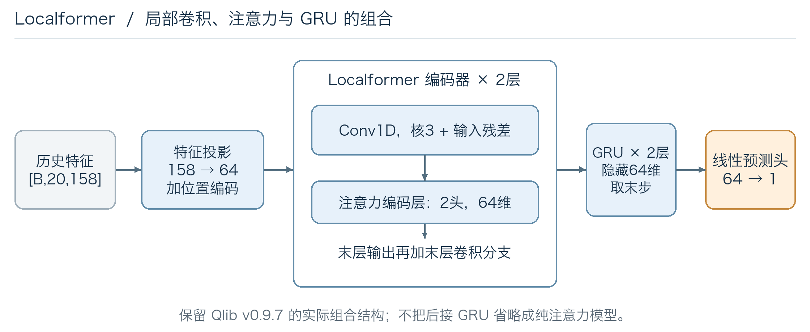

图8  Localformer保留局部卷积、注意力、额外卷积残差及后接GRU。[M8][L1]

Localformer把局部时间模式与窗口范围内的注意力结合起来。卷积先处理邻近日期的变化，再让注意力整合更广范围的信息，适合同时表达短期形态与窗口内的跨期关联。

Qlib v0.9.7的实际实现不只是给Transformer增加一个名称。每层编码器前加入卷积核为3的一维卷积，局部信息与原表示相加后进入注意力层；编码器之后还有GRU，最后读取末端状态并线性预测。[M8]

本轮使用20日乘158维输入，模型维度64、2个注意力头、2层，Dropout为0。沿用该局部卷积、注意力与GRU组合结构，后续年度只微调decoder_layer。[L1][L2]

局部卷积和GRU都属于冻结的特征提取部分。解释实验结果时，应将它视为一个混合架构，不能把相对Transformer的变化全部归因于局部注意力。

## TRA 时间路由适配器

Temporal Routing Adaptor

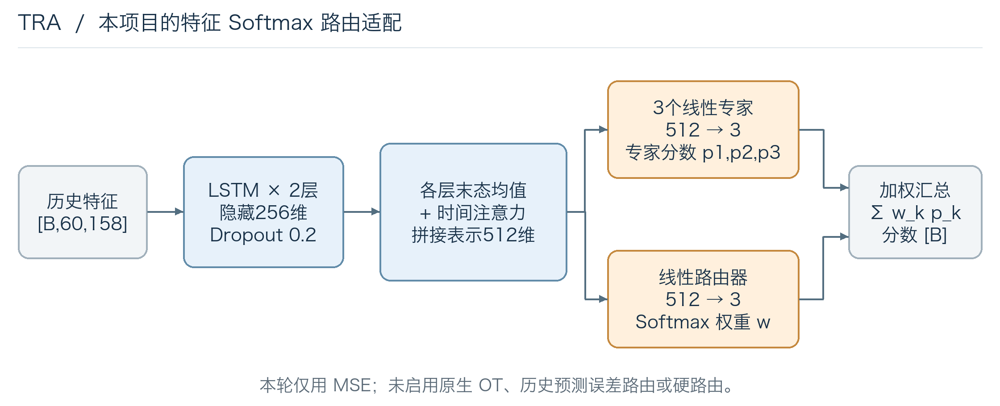

图9  本项目TRA适配：3个线性专家与特征路由器共同构成可微调的预测头。[M9][L1]

TRA旨在处理市场中并存的多种预测模式。共享网络提取表示，多个专家分别预测，路由器决定样本由哪个专家或怎样的组合负责。原论文还通过最优传输约束分配，避免专家缺乏分工。[P5]

Qlib提供TRAModel、RNN或Transformer骨干、路由组件及配套数据集；原生流程可利用历史预测误差等信息。对未兑现的未来收益，必须等标签可得后才能更新这类历史误差，不能提前交给路由器。[M9][Q5]

本轮是统一MSE下的适配版本：使用带注意力的2层LSTM骨干，隐藏维度256、Dropout为0.2，回看60日、158维输入。输出端有3个专家与一个基于特征的Softmax路由器，预测为专家分数的加权和；后续年度两者共同微调。[L1][L2]

本轮没有启用原生最优传输损失、历史误差路由及硬路由机制。因此报告中的TRA应理解为基于TRA思想的特征路由适配模型，不能据此声称已经复现完整原论文。

## TFT 时间融合Transformer

Temporal Fusion Transformer

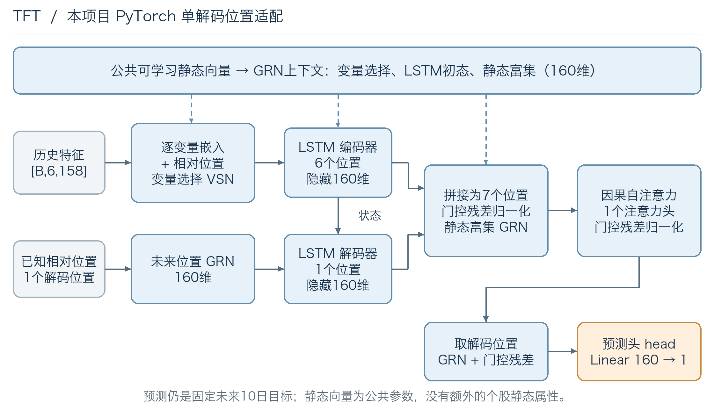

图10  本项目TFT适配。虚线表示静态上下文条件，门控与跳连按模块合并绘制。[M10][L3]

TFT面向多预测期限任务，组合变量选择、门控残差网络、循环层及可解释注意力。它区分静态属性、已知未来输入与历史观测输入，分别处理后再融合。变量选择权重与时间注意力提供观察模型行为的途径。[P4]

Qlib v0.9.7的TFT示例位于benchmarks/TFT目录，由TFTModel封装并使用TensorFlow相关组件；它不是与其他模型完全相同的PyTorch模块。该版本的说明还列出专门的运行环境与数据格式要求。[M10][Q6]

本轮使用本项目的PyTorch适配：6日乘158维输入，隐藏维度160、Dropout为0.4，仅用一个解码位置预测固定的10日目标。输入包含历史特征和相对位置；静态上下文使用可学习公共向量，没有加入真实的个股静态属性。[L1][L3]

本轮用MSE预测单个值，不是原生多期限分位数预测，也不等同于Qlib官方TensorFlow基准。后续年度仅更新最终head，变量选择器与时序融合部分保持冻结。

## TabNet 基于顺序特征选择的表格网络

TabNet

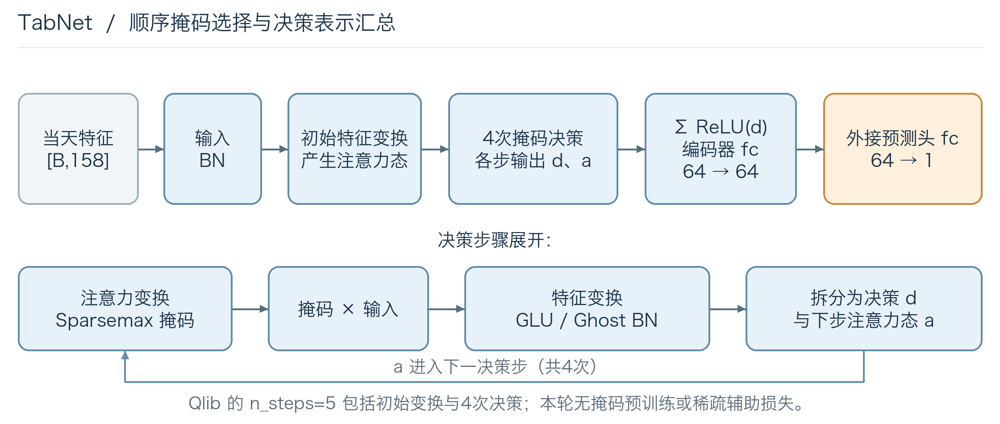

图11  TabNet图中分开显示编码器内部fc与外接预测fc；橙色仅指外接预测头。[M11][L1]

TabNet在多个决策步骤中学习特征掩码，让不同样本关注不同的输入列，再把各步骤的表示合成预测。这里的顺序指决策步骤，不等于按交易日递推。原论文同时讨论了利用未标注数据进行自监督预训练的方法。[P3]

Qlib提供TabnetModel封装以及TabNet编码器、FinetuneModel输出头和预训练重建组件。原生实现能够返回稀疏相关项，是否使用预训练和辅助损失取决于具体训练流程。[M11]

本轮输入当天158维Alpha158，编码输出64维，使用5步配置、relax为1.3、虚拟批大小2048，再接单输出线性层。本轮从头进行监督训练，没有执行额外的掩码预训练，也没有把稀疏辅助项加入统一MSE损失。[L1][L2]

名称中的决策步骤不意味着它是树模型。后续年度冻结TabNet编码器和归一化缓冲，只调整外接fc，原有特征选择机制不随新年度重新学习。

## SFM 状态频率记忆网络

State Frequency Memory

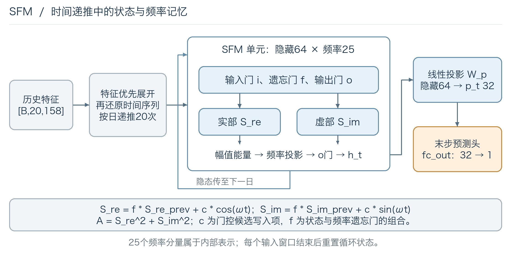

图12  SFM通过实部和虚部频率记忆构建隐藏态；W_p为内部投影，fc_out为预测头。[M12][L1]

SFM在循环记忆中增加频率维度，用不同频率上的状态表达快慢不同的时间变化。它不只是记住最近发生了什么，也尝试分开表示不同变化节奏，然后汇总成股票预测。

Qlib的SFM训练封装使用内部SFM_Model。网络显式维护实部、虚部与频率状态，并通过门控更新这些状态；原生输入需要按特征优先的次序组织，不能随意把时间轴与特征轴交换。[M12]

本轮回看20日、输入158维，隐藏维度64，中间输出维度32，频率维度25，dropout_W与dropout_U均设为0.5；按该实现的实际前向执行。适配器先按特征优先展开输入，后续年度只训练fc_out。[L1][L2]

25个频率分量不等于25个已被经济学验证的市场周期。它们是模型内部表示。与其他模型比较时，还应考虑窗口、优化过程和种子波动；频率记忆结构本身不构成收益保证。

## 本轮实验的统一设置

下面说明的是这轮12模型实验的既定设置，便于理解前面的模型对照。它不是Qlib的默认配置，也不构成模型之间效果排名。每个模型都具有5条独立种子链，首年完整训练，随后逐年继承同一种子的上一年验证最佳参数。[L1][L2][L4]

| 测试年 | 训练样本区间 | 验证年 | 年度阶段 |
| --- | --- | --- | --- |
| 2022 | 2013年至2020年末 | 2021 | 全部参数训练 |
| 2023 | 2013年至2021年末 | 2022 | 继承参数微调 |
| 2024 | 2013年至2022年末 | 2023 | 继承参数微调 |
| 2025 | 2013年至2023年末 | 2024 | 继承参数微调 |
| 2026 | 2013年至2024年末 | 2025 | 微调并测试至10月13日 |

### 训练与选模

统一预测未来10个交易日的中性化VWAP收益，以MSE训练；验证集以每日截面Spearman RankIC的均值选轮。每年度最多30轮，连续5轮无改善停止。后续年度允许把继承的未更新模型作为候选。每年再按验证分数选主结果种子，另报五条固定种子路径的范围和标准差。

后续年度冻结特征提取器及其运行缓冲，只训练声明的预测头；学习率固定为初始值的十分之一，年度优化器重新建立。输入标准化固定使用首阶段训练区间拟合的版本。训练数据仍是扩展后的完整合格窗口，包含历史年份及新增训练年份，而不只是新增的一年。

### 预测与交易

年内不做逐日参数更新。组合按周选择预测排名前10%的股票等权买入，下一交易日VWAP成交，买卖各7.5bp，跨年承接持仓和现金。每个模型有5个种子、5个年度阶段，总计300个训练或微调阶段。

### 如何解释这样的比较

这轮实验比较的是各结构在统一监督目标和年度预测头微调条件下的表现。不同模型的回看长度和结构仍有差异，不能称为完全相同的输入容量实验。TRA与TFT还涉及原生机制取舍，TabNet未启用额外预训练和稀疏辅助损失。后续年度只训练输出端，也限制了网络重新学习新特征表示的能力。

## Qlib模块与本轮输入设置速查

除TFT外，下表模块均位于qlib.contrib.model下。封装类是通常用于Qlib任务配置的入口；本轮实际训练调用的是对应网络或显式适配器，并非逐一调用这些封装类的原生fit。[M1至M12][L1][L2]

| 模型 | Qlib模块 | 标准封装类 |
| --- | --- | --- |
| MLP | pytorch_nn | DNNModelPytorch |
| LSTM | pytorch_lstm_ts | LSTM |
| GRU | pytorch_gru_ts | GRU |
| ALSTM | pytorch_alstm_ts | ALSTM |
| GATs | pytorch_gats_ts | GATs |
| TCN | pytorch_tcn_ts | TCN |
| Transformer | pytorch_transformer_ts | TransformerModel |
| Localformer | pytorch_localformer_ts | LocalformerModel |
| TRA | pytorch_tra | TRAModel |
| TFT | examples/benchmarks/TFT/tft.py | TFTModel |
| TabNet | pytorch_tabnet | TabnetModel |
| SFM | pytorch_sfm | SFM |

### 输入和微调参数

| 模型 | 历史日数 | 初始学习率 | 后续年度可训练部分 |
| --- | --- | --- | --- |
| MLP | 1 | 0.001 | dnn_layers.3 |
| LSTM | 20 | 0.001 | network.fc_out |
| GRU | 20 | 0.0002 | network.fc_out |
| ALSTM | 20 | 0.001 | network.fc_out |
| GATs | 20 | 0.001 | fc_out |
| TCN | 20 | 0.0001 | network.linear |
| Transformer | 20 | 0.0001 | network.decoder_layer |
| Localformer | 20 | 0.0001 | network.decoder_layer |
| TRA | 60 | 0.001 | head 内专家和路由器 |
| TFT | 6 | 0.0001 | network.head |
| TabNet | 1 | 0.01 | network.fc |
| SFM | 20 | 0.001 | network.fc_out |

上表输出层名称相对于本轮base网络封装；其用途是准确说明冻结边界。本轮各模型输出均为一个股票分数。MLP和TabNet使用当天向量，其他模型使用历史矩阵；TCN与SFM会在适配器内部转换轴顺序。[L1][L2]

## 官方文档与模型源码

以下链接固定核对Qlib v0.9.7；官方文档使用标明0.9.7的stable页面。阅读其他版本时，应重新核对类名、默认参数和训练逻辑。核对日期为2026年11月24日。

\[Q1\] [模型训练与预测接口](https://qlib.readthedocs.io/en/stable/component/model.html)

\[Q2\] [数据层与数据集](https://qlib.readthedocs.io/en/stable/component/data.html)

\[Q3\] [自定义模型集成](https://qlib.readthedocs.io/en/stable/start/integration.html)

\[Q4\] [MLP Alpha158官方配置](https://github.com/microsoft/qlib/blob/v0.9.7/examples/benchmarks/MLP/workflow_config_mlp_Alpha158.yaml)

\[Q5\] [TRA使用说明与完整Alpha158配置说明](https://github.com/microsoft/qlib/blob/v0.9.7/examples/benchmarks/TRA/README.md)

\[Q6\] [TFT示例运行说明](https://github.com/microsoft/qlib/blob/v0.9.7/examples/benchmarks/TFT/README.md)

\[M1\] [MLP DNNModelPytorch 官方源码](https://github.com/microsoft/qlib/blob/v0.9.7/qlib/contrib/model/pytorch_nn.py)

\[M2\] [LSTM LSTM 官方源码](https://github.com/microsoft/qlib/blob/v0.9.7/qlib/contrib/model/pytorch_lstm_ts.py)

\[M3\] [GRU GRU 官方源码](https://github.com/microsoft/qlib/blob/v0.9.7/qlib/contrib/model/pytorch_gru_ts.py)

\[M4\] [ALSTM ALSTM 官方源码](https://github.com/microsoft/qlib/blob/v0.9.7/qlib/contrib/model/pytorch_alstm_ts.py)

\[M5\] [GATs GATs 官方源码](https://github.com/microsoft/qlib/blob/v0.9.7/qlib/contrib/model/pytorch_gats_ts.py)

\[M6\] [TCN TCN 官方源码](https://github.com/microsoft/qlib/blob/v0.9.7/qlib/contrib/model/pytorch_tcn_ts.py)

\[M7\] [Transformer TransformerModel 官方源码](https://github.com/microsoft/qlib/blob/v0.9.7/qlib/contrib/model/pytorch_transformer_ts.py)

\[M8\] [Localformer LocalformerModel 官方源码](https://github.com/microsoft/qlib/blob/v0.9.7/qlib/contrib/model/pytorch_localformer_ts.py)

\[M9\] [TRA TRAModel 官方源码](https://github.com/microsoft/qlib/blob/v0.9.7/qlib/contrib/model/pytorch_tra.py)

\[M10\] [TFT TFTModel 官方源码](https://github.com/microsoft/qlib/blob/v0.9.7/examples/benchmarks/TFT/tft.py)

\[M11\] [TabNet TabnetModel 官方源码](https://github.com/microsoft/qlib/blob/v0.9.7/qlib/contrib/model/pytorch_tabnet.py)

\[M12\] [SFM SFM 官方源码](https://github.com/microsoft/qlib/blob/v0.9.7/qlib/contrib/model/pytorch_sfm.py)

源码阅读建议：先找内部网络的forward，再找训练封装的fit与predict；随后检查示例YAML中的特征筛选、目标标签和回测设置。这样可以区分架构本身、训练实现和策略规则各自的作用。

## 原论文与本项目实现依据

\[P1\] [Bai等 2018 卷积与循环序列模型比较及TCN](https://arxiv.org/abs/1803.01271)

\[P2\] [Vaswani等 2017 Attention Is All You Need](https://arxiv.org/abs/1706.03762)

\[P3\] [Arik与Pfister TabNet](https://arxiv.org/abs/1908.07442)

\[P4\] [Lim等 Temporal Fusion Transformers](https://arxiv.org/abs/1912.09363)

\[P5\] [Lin等 2021 TRA与最优传输](https://arxiv.org/abs/2106.12950)

### 本项目的核对文件

本轮模型结构和训练参数依据以下归档代码与实验口径核对。文件位置采用项目内相对路径，便于与实际实现逐项对应。源码校验值记录在配套内部清单中。

**[L1] 年度模型封装与原生网络构建**

废弃/01_模型项目/alpha158-final-baseline/models.py

废弃/01_模型项目/alpha158-model-suite/models_core.py

**[L2] 统一训练器及图模型构建**

废弃/01_模型项目/alpha158-final-baseline/train.py

废弃/01_模型项目/alpha158-model-suite/models_group.py

**[L3] 本项目PyTorch TFT适配**

废弃/01_模型项目/alpha158-model-suite/models_tft.py

**[L4] 本轮固定实验口径**

废弃/04_配套脚本与实验口径/实验口径.json

本说明解释模型和实现，不用模型名称推断收益高低。实际效果需要在同一时期、同一股票池、同一费用口径下，结合完整测试路径和种子波动判断。
