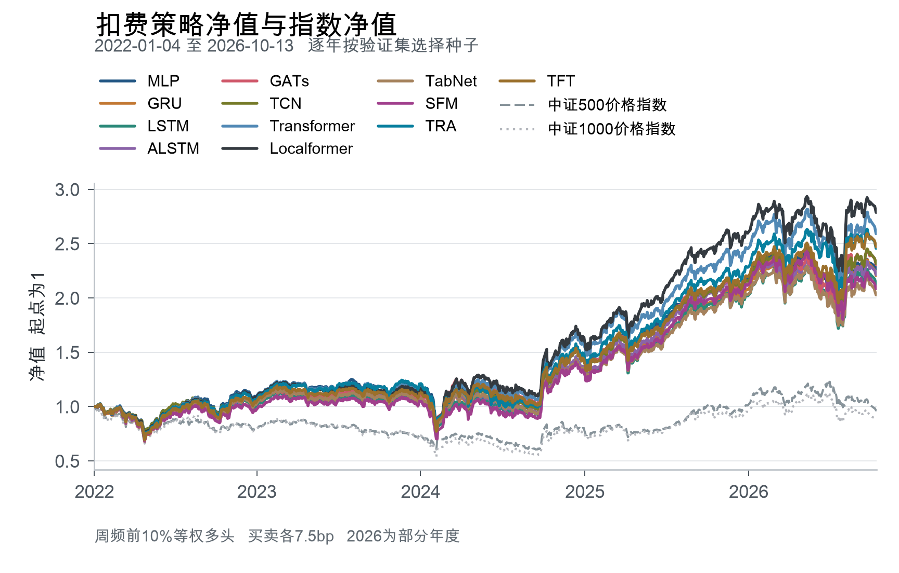
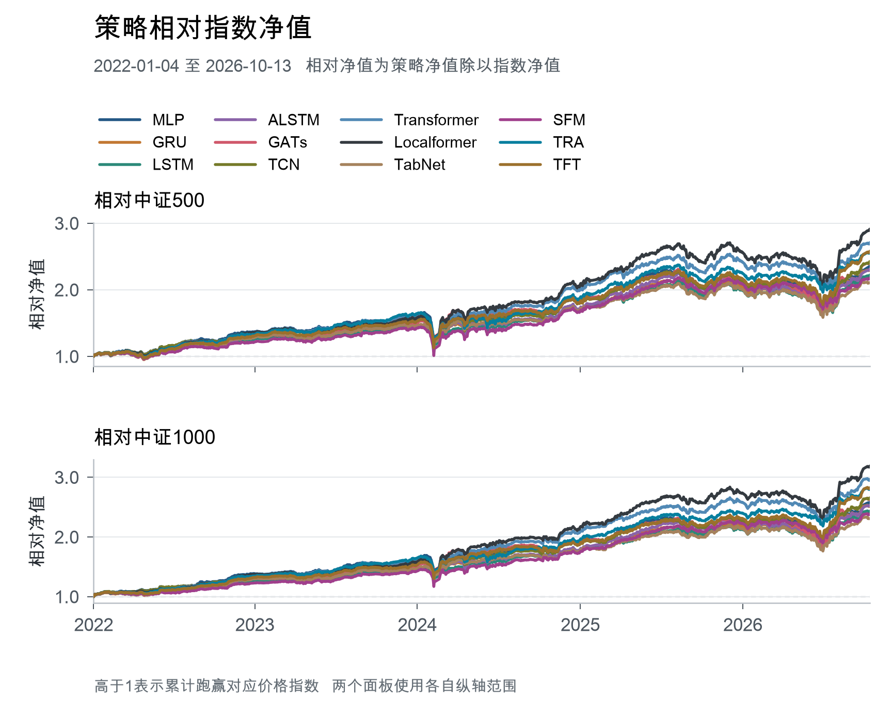
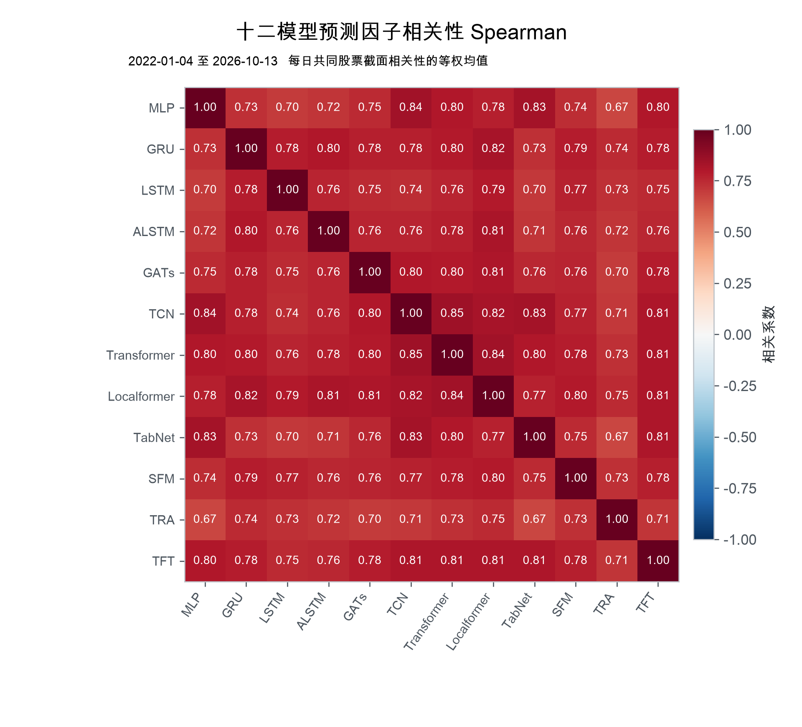
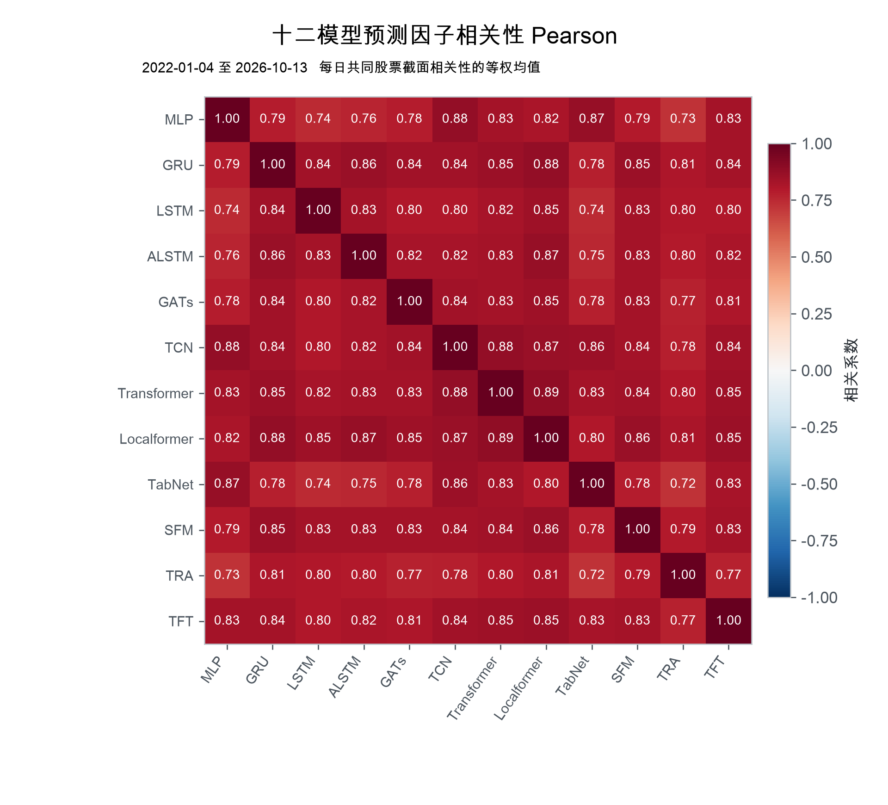

这份报告对应十二个神经网络、五个种子和五个测试年度，共60条种子链、300个年度阶段。本文保留完整报告的指标表、年度结果、种子波动与回测曲线，便于和模型架构对照阅读。

[下载完整Word报告](/downloads/alpha158-20261125/alpha158-twelve-models-results.docx) · [阅读模型原理与十二张架构图](/posts/alpha158-twelve-models-qlib-architectures/)

表格可左右滑动查看完整列，曲线图片可点击放大。

**口径边界**：这批结果采用首年全参数训练、随后年度只微调预测头。每年按上一年验证RankIC选择种子。费用为买入7.5bp、卖出7.5bp；2026年仅截至10月13日，因子收益标签评价截至9月18日。下文全部结果均对应这批已完成实验，不将其改写为独立重训结果。

> 2022至2026测试 五种子连续年度微调

交付快照 2026年11月25日 09:14 北京时间  |  完整完成 12 / 12 个模型 共300个年度阶段

十二个神经网络均已完成五种子、五年度训练、预测和回测，共60条种子链、300个年度阶段。训练于2026年11月25日08:39北京时间结束。本文汇总本项目统一口径的完整baseline结果，覆盖2022年至2026年10月13日，2026为部分年度。主路径逐年按上一年验证RankIC选种子；测试收益不参与选种。

本批中Localformer主路径扣费年化25.27%、Sharpe 0.966，两者均居十二模型首位；RankIC为10.62%。这些是共同测试期的描述性结果，不据此重选种子或改变后续训练设置。

### 全期因子与扣费策略对照

| 模型 | IC | RankIC | ICIR / 日频 | 扣费年化 | Sharpe | 策略回撤 |
| --- | --- | --- | --- | --- | --- | --- |
| MLP | 11.31% | 10.09% | 1.337 | 19.61% | 0.834 | -36.25% |
| GRU | 11.96% | 10.05% | 1.492 | 19.06% | 0.785 | -35.24% |
| LSTM | 11.60% | 9.70% | 1.496 | 18.09% | 0.749 | -35.81% |
| ALSTM | 12.08% | 10.04% | 1.492 | 19.10% | 0.776 | -36.37% |
| GATs | 11.58% | 9.81% | 1.386 | 20.09% | 0.840 | -33.21% |
| TCN | 11.85% | 10.21% | 1.445 | 20.36% | 0.848 | -37.21% |
| Transformer | 12.21% | 10.15% | 1.508 | 23.31% | 0.901 | -36.93% |
| Localformer | 12.25% | 10.62% | 1.466 | 25.27% | 0.966 | -35.09% |
| TabNet | 11.22% | 10.05% | 1.398 | 16.75% | 0.728 | -35.17% |
| SFM | 11.70% | 9.93% | 1.420 | 17.57% | 0.729 | -36.15% |
| TRA | 11.76% | 9.98% | 1.542 | 21.96% | 0.858 | -35.21% |
| TFT | 12.15% | 10.01% | 1.564 | 22.00% | 0.882 | -35.22% |

## 同一策略相对两个价格指数

| 模型 | 500超额 / 年化 | 500超额 / IR | 500相对 / 回撤 | 1000超额 / 年化 | 1000超额 / IR | 1000相对 / 回撤 |
| --- | --- | --- | --- | --- | --- | --- |
| MLP | 20.59% | 1.253 | -30.76% | 23.01% | 1.671 | -21.49% |
| GRU | 20.03% | 1.293 | -26.81% | 22.44% | 1.844 | -16.44% |
| LSTM | 19.05% | 1.228 | -27.00% | 21.44% | 1.770 | -18.40% |
| ALSTM | 20.08% | 1.254 | -28.18% | 22.48% | 1.797 | -21.03% |
| GATs | 21.08% | 1.345 | -29.00% | 23.50% | 1.833 | -21.29% |
| TCN | 21.35% | 1.316 | -30.33% | 23.78% | 1.802 | -20.56% |
| Transformer | 24.32% | 1.497 | -28.31% | 26.81% | 2.134 | -18.16% |
| Localformer | 26.30% | 1.577 | -27.32% | 28.83% | 2.183 | -18.70% |
| TabNet | 17.70% | 1.161 | -25.43% | 20.06% | 1.630 | -20.04% |
| SFM | 18.53% | 1.167 | -29.80% | 20.90% | 1.660 | -19.86% |
| TRA | 22.96% | 1.429 | -29.37% | 25.42% | 2.036 | -19.37% |
| TFT | 23.00% | 1.437 | -27.73% | 25.46% | 2.004 | -17.66% |

净值为2022-01-04至2026-10-13，共1154个日期、1153期收益；2026为部分年度。因子统计1143个有效日期，截至2026-09-18。各模型完整ICIR及RankICIR日频和年化值见各自逐年结果页，种子波动见后附四页。

## 年度滚动与种子选择

首个2022测试阶段从头训练；随后每年继承同模型、同种子上一年验证最佳参数，在扩展后的全部合格训练样本上微调。年内不更新参数。

| 测试年 | 训练区间 | 验证年 | 训练样本数 | 验证样本数 |
| --- | --- | --- | --- | --- |
| 2022 | 2013 至 2020 | 2021 | 4,822,327 | 846,635 |
| 2023 | 2013 至 2021 | 2022 | 5,707,993 | 962,413 |
| 2024 | 2013 至 2022 | 2023 | 6,715,051 | 1,051,132 |
| 2025 | 2013 至 2023 | 2024 | 7,815,369 | 1,112,597 |
| 2026 | 2013 至 2024 | 2025 | 8,980,901 | 1,124,221 |

### 主路径逐年入选种子和最佳轮次

| 模型 | 2022 | 2023 | 2024 | 2025 | 2026 |
| --- | --- | --- | --- | --- | --- |
| MLP | 101 / 8轮 | 101 / 0轮 | 202 / 12轮 | 303 / 5轮 | 303 / 8轮 |
| GRU | 505 / 1轮 | 505 / 0轮 | 505 / 1轮 | 303 / 0轮 | 202 / 0轮 |
| LSTM | 505 / 1轮 | 505 / 0轮 | 505 / 1轮 | 505 / 1轮 | 505 / 1轮 |
| ALSTM | 505 / 1轮 | 505 / 0轮 | 303 / 7轮 | 303 / 6轮 | 505 / 0轮 |
| GATs | 202 / 4轮 | 303 / 0轮 | 303 / 30轮 | 101 / 22轮 | 404 / 0轮 |
| TCN | 202 / 2轮 | 202 / 0轮 | 303 / 0轮 | 202 / 4轮 | 505 / 0轮 |
| Transformer | 202 / 2轮 | 505 / 0轮 | 505 / 1轮 | 505 / 10轮 | 101 / 0轮 |
| Localformer | 505 / 1轮 | 505 / 0轮 | 505 / 3轮 | 505 / 0轮 | 505 / 0轮 |
| TabNet | 303 / 4轮 | 303 / 0轮 | 303 / 6轮 | 303 / 5轮 | 101 / 0轮 |
| SFM | 505 / 1轮 | 505 / 0轮 | 505 / 0轮 | 505 / 1轮 | 505 / 0轮 |
| TRA | 505 / 1轮 | 505 / 0轮 | 505 / 0轮 | 202 / 13轮 | 404 / 9轮 |
| TFT | 101 / 1轮 | 505 / 4轮 | 505 / 8轮 | 303 / 30轮 | 505 / 10轮 |

各单元格列出种子与最佳轮次；完整验证RankIC和逐日序列随数据包交付。

最佳轮为0表示继承的上一年度最佳参数在当前验证集上优于本阶段后续微调轮次，因此保留起点。第一年度至少训练一轮。种子选择只使用前一年验证数据，测试收益不参与选择。

## 训练和交易规则

输入为完整Alpha158的158项特征，包含VWAP0。训练目标为未来10个交易日中性化收益，原始收益定义为信号后第11个交易日VWAP除以第1个交易日VWAP再减1。采用MSE、AdamW，每阶段最多30轮，验证每日真实RankIC连续5轮无改善停止。

2022阶段全部参数可训练。2023至2026冻结特征提取层、运行缓冲和首阶段归一化，只更新预测头；学习率为初始学习率的0.1倍，不逐年连乘，每年重新建立优化器。各模型初始学习率、回看长度和预测头规模见模型设置表。

归一化的中位数和MAD由首阶段训练历史中固定的131072条样本估计，随后冻结；模型梯度训练仍使用表中全部合格样本。沿用冻结版本的同日截面缺失填充；训练锚点要求原始158列完整。

周末收盘信号、下一交易日VWAP执行，等权买入共同候选池预测前10%，数量向上取整；买卖各7.5bp，无指数增强约束，保留停牌、缺价和涨跌停方向限制。2022年初从现金开始，之后跨年承接持仓、现金与净值。

## 扣费策略净值

曲线使用逐年验证选种子的连续策略。两个基准只用于评价同一持仓路径，不分别重新构造组合。

图1  策略已扣除买卖各7.5bp费用；指数为未含分红的价格指数，起点均为1。

## 相对中证500和中证1000的净值

相对净值为同一策略净值除以对应指数净值，起点均为1。

图2  相对净值为策略净值除以基准净值，起点为1。最大回撤按完整逐日路径计算，不能由少量年度收益或图上端点替代。

## 预测因子相关性

本页比较不同模型给同一天股票打出的预测分数。每天在同一个合格股票池计算截面Spearman相关，再按交易日等权平均。相关系数越高，模型对股票的排序越相似。图中采用各模型逐年验证入选种子。

全期非对角相关系数最低为MLP与TRA的0.667，最高为TCN与Transformer的0.846。相关性仅描述预测相似度，不能直接证明组合后收益会改善。

覆盖1154个信号日期，2022-01-04至2026-10-13。计算模型间相关性无需未来收益标签，因此末日与净值一致；因子对真实收益的IC评价仍止于2026-09-18。Pearson以及各年完整相关矩阵、逐日序列随包交付。

## MLP 逐年结果

各年结果沿用同一连续持仓路径，年初不清仓或重置净值。2026仅覆盖至10月13日；下表收益和超额列均为年化值。

全期ICIR日频 1.337、年化 21.224；RankICIR日频 1.227、年化 19.474。

### 因子表现

| 年度 | IC | RankIC | ICIR / 日频 | RankICIR / 日频 | ICIR / 年化 | RankICIR / 年化 |
| --- | --- | --- | --- | --- | --- | --- |
| 2022 | 11.96% | 10.59% | 1.802 | 1.900 | 28.604 | 30.155 |
| 2023 | 10.81% | 8.81% | 1.364 | 1.093 | 21.648 | 17.358 |
| 2024 | 12.59% | 10.37% | 1.427 | 1.085 | 22.647 | 17.217 |
| 2025 | 11.84% | 11.23% | 1.489 | 1.441 | 23.640 | 22.880 |
| 2026 部分 | 8.57% | 9.19% | 0.798 | 0.942 | 12.673 | 14.961 |

### 扣费策略表现

| 年度 | 扣费年化收益 | Sharpe | 策略最大回撤 | 收益期数 |
| --- | --- | --- | --- | --- |
| 2022 | 9.56% | 0.485 | -28.40% | 241 |
| 2023 | 9.03% | 0.704 | -12.31% | 242 |
| 2024 | 20.50% | 0.698 | -33.24% | 242 |
| 2025 | 56.06% | 2.290 | -11.64% | 243 |
| 2026 部分 | 5.72% | 0.343 | -25.31% | 185 |

### 相对两个价格指数的表现

| 年度 | 500超额 / 年化 | 500超额 / IR | 500相对 / 回撤 | 1000超额 / 年化 | 1000超额 / IR | 1000相对 / 回撤 |
| --- | --- | --- | --- | --- | --- | --- |
| 2022 | 38.82% | 3.556 | -5.31% | 40.77% | 4.173 | -2.13% |
| 2023 | 18.15% | 2.471 | -4.55% | 16.65% | 2.339 | -3.84% |
| 2024 | 14.01% | 0.637 | -30.76% | 19.02% | 1.008 | -21.49% |
| 2025 | 18.52% | 1.444 | -12.22% | 21.32% | 1.961 | -7.18% |
| 2026 部分 | 13.52% | 0.635 | -22.60% | 17.62% | 0.962 | -20.50% |

因子有效日期数依次为242、242、242、243、174；2026年因子评价止于9月18日。2023年起的年度收益包含从上一年最后交易日承接的首日收益；2022年初始化日不计作收益期。

逐年指标与全期指标直接从各自的完整日序列计算，全期Sharpe、ICIR、超额IR和回撤不能用年度数值做简单平均。

## GRU 逐年结果

各年结果沿用同一连续持仓路径，年初不清仓或重置净值。2026仅覆盖至10月13日；下表收益和超额列均为年化值。

全期ICIR日频 1.492、年化 23.688；RankICIR日频 1.273、年化 20.210。

### 因子表现

| 年度 | IC | RankIC | ICIR / 日频 | RankICIR / 日频 | ICIR / 年化 | RankICIR / 年化 |
| --- | --- | --- | --- | --- | --- | --- |
| 2022 | 13.24% | 10.95% | 1.997 | 1.869 | 31.705 | 29.676 |
| 2023 | 11.50% | 8.56% | 1.441 | 1.203 | 22.878 | 19.095 |
| 2024 | 12.99% | 10.17% | 1.444 | 1.049 | 22.929 | 16.658 |
| 2025 | 12.18% | 11.50% | 1.587 | 1.425 | 25.188 | 22.626 |
| 2026 部分 | 9.08% | 8.70% | 1.113 | 1.102 | 17.671 | 17.496 |

### 扣费策略表现

| 年度 | 扣费年化收益 | Sharpe | 策略最大回撤 | 收益期数 |
| --- | --- | --- | --- | --- |
| 2022 | 0.45% | 0.153 | -33.73% | 241 |
| 2023 | 7.38% | 0.542 | -13.16% | 242 |
| 2024 | 23.21% | 0.744 | -31.18% | 242 |
| 2025 | 60.85% | 2.284 | -14.35% | 243 |
| 2026 部分 | 9.52% | 0.466 | -20.94% | 185 |

### 相对两个价格指数的表现

| 年度 | 500超额 / 年化 | 500超额 / IR | 500相对 / 回撤 | 1000超额 / 年化 | 1000超额 / IR | 1000相对 / 回撤 |
| --- | --- | --- | --- | --- | --- | --- |
| 2022 | 27.28% | 2.363 | -9.78% | 29.06% | 3.204 | -4.34% |
| 2023 | 16.36% | 2.071 | -4.65% | 14.88% | 2.267 | -3.52% |
| 2024 | 16.58% | 0.786 | -26.81% | 21.69% | 1.271 | -16.44% |
| 2025 | 22.15% | 1.687 | -12.08% | 25.04% | 2.416 | -6.16% |
| 2026 部分 | 17.61% | 0.971 | -15.62% | 21.85% | 1.471 | -13.47% |

因子有效日期数依次为242、242、242、243、174；2026年因子评价止于9月18日。2023年起的年度收益包含从上一年最后交易日承接的首日收益；2022年初始化日不计作收益期。

逐年指标与全期指标直接从各自的完整日序列计算，全期Sharpe、ICIR、超额IR和回撤不能用年度数值做简单平均。

## LSTM 逐年结果

各年结果沿用同一连续持仓路径，年初不清仓或重置净值。2026仅覆盖至10月13日；下表收益和超额列均为年化值。

全期ICIR日频 1.496、年化 23.747；RankICIR日频 1.287、年化 20.424。

### 因子表现

| 年度 | IC | RankIC | ICIR / 日频 | RankICIR / 日频 | ICIR / 年化 | RankICIR / 年化 |
| --- | --- | --- | --- | --- | --- | --- |
| 2022 | 12.77% | 10.27% | 2.058 | 1.760 | 32.677 | 27.941 |
| 2023 | 10.87% | 8.13% | 1.534 | 1.224 | 24.344 | 19.433 |
| 2024 | 12.38% | 9.71% | 1.434 | 1.079 | 22.771 | 17.125 |
| 2025 | 12.00% | 11.16% | 1.670 | 1.604 | 26.515 | 25.464 |
| 2026 部分 | 9.34% | 9.00% | 0.993 | 1.020 | 15.765 | 16.188 |

### 扣费策略表现

| 年度 | 扣费年化收益 | Sharpe | 策略最大回撤 | 收益期数 |
| --- | --- | --- | --- | --- |
| 2022 | 0.23% | 0.145 | -31.99% | 241 |
| 2023 | 7.79% | 0.559 | -13.61% | 242 |
| 2024 | 24.42% | 0.767 | -32.38% | 242 |
| 2025 | 54.62% | 2.042 | -16.00% | 243 |
| 2026 部分 | 8.01% | 0.414 | -24.78% | 185 |

### 相对两个价格指数的表现

| 年度 | 500超额 / 年化 | 500超额 / IR | 500相对 / 回撤 | 1000超额 / 年化 | 1000超额 / IR | 1000相对 / 回撤 |
| --- | --- | --- | --- | --- | --- | --- |
| 2022 | 27.00% | 2.307 | -9.72% | 28.77% | 3.206 | -3.21% |
| 2023 | 16.80% | 2.147 | -6.07% | 15.31% | 2.404 | -3.87% |
| 2024 | 17.71% | 0.854 | -27.00% | 22.88% | 1.421 | -16.67% |
| 2025 | 17.42% | 1.425 | -11.02% | 20.19% | 2.193 | -4.95% |
| 2026 部分 | 15.98% | 0.786 | -19.99% | 20.16% | 1.160 | -17.91% |

因子有效日期数依次为242、242、242、243、174；2026年因子评价止于9月18日。2023年起的年度收益包含从上一年最后交易日承接的首日收益；2022年初始化日不计作收益期。

逐年指标与全期指标直接从各自的完整日序列计算，全期Sharpe、ICIR、超额IR和回撤不能用年度数值做简单平均。

## ALSTM 逐年结果

各年结果沿用同一连续持仓路径，年初不清仓或重置净值。2026仅覆盖至10月13日；下表收益和超额列均为年化值。

全期ICIR日频 1.492、年化 23.683；RankICIR日频 1.276、年化 20.256。

### 因子表现

| 年度 | IC | RankIC | ICIR / 日频 | RankICIR / 日频 | ICIR / 年化 | RankICIR / 年化 |
| --- | --- | --- | --- | --- | --- | --- |
| 2022 | 13.33% | 11.05% | 2.041 | 1.824 | 32.401 | 28.948 |
| 2023 | 11.18% | 8.13% | 1.387 | 1.102 | 22.023 | 17.488 |
| 2024 | 13.37% | 10.19% | 1.614 | 1.132 | 25.621 | 17.965 |
| 2025 | 12.46% | 11.32% | 1.728 | 1.580 | 27.435 | 25.080 |
| 2026 部分 | 9.28% | 9.31% | 0.923 | 0.994 | 14.658 | 15.780 |

### 扣费策略表现

| 年度 | 扣费年化收益 | Sharpe | 策略最大回撤 | 收益期数 |
| --- | --- | --- | --- | --- |
| 2022 | 2.55% | 0.229 | -33.42% | 241 |
| 2023 | 10.15% | 0.694 | -12.47% | 242 |
| 2024 | 19.60% | 0.656 | -33.85% | 242 |
| 2025 | 62.12% | 2.192 | -16.41% | 243 |
| 2026 部分 | 6.34% | 0.361 | -22.82% | 185 |

### 相对两个价格指数的表现

| 年度 | 500超额 / 年化 | 500超额 / IR | 500相对 / 回撤 | 1000超额 / 年化 | 1000超额 / IR | 1000相对 / 回撤 |
| --- | --- | --- | --- | --- | --- | --- |
| 2022 | 29.94% | 2.594 | -9.65% | 31.76% | 3.632 | -4.65% |
| 2023 | 19.36% | 2.326 | -5.50% | 17.84% | 2.614 | -3.88% |
| 2024 | 13.15% | 0.661 | -28.18% | 18.12% | 1.120 | -18.01% |
| 2025 | 23.13% | 1.699 | -11.36% | 26.03% | 2.489 | -5.28% |
| 2026 部分 | 14.19% | 0.712 | -21.63% | 18.30% | 1.079 | -18.97% |

因子有效日期数依次为242、242、242、243、174；2026年因子评价止于9月18日。2023年起的年度收益包含从上一年最后交易日承接的首日收益；2022年初始化日不计作收益期。

逐年指标与全期指标直接从各自的完整日序列计算，全期Sharpe、ICIR、超额IR和回撤不能用年度数值做简单平均。

## GATs 逐年结果

各年结果沿用同一连续持仓路径，年初不清仓或重置净值。2026仅覆盖至10月13日；下表收益和超额列均为年化值。

全期ICIR日频 1.386、年化 21.994；RankICIR日频 1.224、年化 19.430。

### 因子表现

| 年度 | IC | RankIC | ICIR / 日频 | RankICIR / 日频 | ICIR / 年化 | RankICIR / 年化 |
| --- | --- | --- | --- | --- | --- | --- |
| 2022 | 12.54% | 10.26% | 1.840 | 1.657 | 29.210 | 26.302 |
| 2023 | 11.61% | 8.86% | 1.549 | 1.236 | 24.594 | 19.628 |
| 2024 | 12.89% | 9.90% | 1.554 | 1.125 | 24.662 | 17.855 |
| 2025 | 11.55% | 10.79% | 1.450 | 1.359 | 23.019 | 21.575 |
| 2026 部分 | 8.45% | 9.02% | 0.770 | 0.904 | 12.229 | 14.349 |

### 扣费策略表现

| 年度 | 扣费年化收益 | Sharpe | 策略最大回撤 | 收益期数 |
| --- | --- | --- | --- | --- |
| 2022 | 2.23% | 0.219 | -33.21% | 241 |
| 2023 | 7.97% | 0.607 | -12.14% | 242 |
| 2024 | 32.11% | 0.965 | -27.84% | 242 |
| 2025 | 50.22% | 2.225 | -11.47% | 243 |
| 2026 部分 | 11.99% | 0.548 | -22.56% | 185 |

### 相对两个价格指数的表现

| 年度 | 500超额 / 年化 | 500超额 / IR | 500相对 / 回撤 | 1000超额 / 年化 | 1000超额 / IR | 1000相对 / 回撤 |
| --- | --- | --- | --- | --- | --- | --- |
| 2022 | 29.53% | 2.385 | -10.44% | 31.35% | 3.417 | -4.33% |
| 2023 | 17.00% | 2.409 | -4.02% | 15.52% | 2.534 | -3.18% |
| 2024 | 24.99% | 1.134 | -22.75% | 30.48% | 1.741 | -12.22% |
| 2025 | 14.09% | 1.168 | -12.36% | 16.78% | 1.573 | -6.71% |
| 2026 部分 | 20.26% | 0.954 | -22.66% | 24.60% | 1.326 | -20.57% |

因子有效日期数依次为242、242、242、243、174；2026年因子评价止于9月18日。2023年起的年度收益包含从上一年最后交易日承接的首日收益；2022年初始化日不计作收益期。

逐年指标与全期指标直接从各自的完整日序列计算，全期Sharpe、ICIR、超额IR和回撤不能用年度数值做简单平均。

## TCN 逐年结果

各年结果沿用同一连续持仓路径，年初不清仓或重置净值。2026仅覆盖至10月13日；下表收益和超额列均为年化值。

全期ICIR日频 1.445、年化 22.935；RankICIR日频 1.259、年化 19.981。

### 因子表现

| 年度 | IC | RankIC | ICIR / 日频 | RankICIR / 日频 | ICIR / 年化 | RankICIR / 年化 |
| --- | --- | --- | --- | --- | --- | --- |
| 2022 | 12.94% | 10.89% | 1.900 | 1.938 | 30.168 | 30.771 |
| 2023 | 11.26% | 9.20% | 1.457 | 1.166 | 23.127 | 18.507 |
| 2024 | 12.80% | 9.94% | 1.465 | 1.019 | 23.252 | 16.173 |
| 2025 | 12.26% | 11.47% | 1.503 | 1.423 | 23.866 | 22.589 |
| 2026 部分 | 9.23% | 9.28% | 0.996 | 1.073 | 15.806 | 17.034 |

### 扣费策略表现

| 年度 | 扣费年化收益 | Sharpe | 策略最大回撤 | 收益期数 |
| --- | --- | --- | --- | --- |
| 2022 | 7.55% | 0.412 | -29.00% | 241 |
| 2023 | 5.43% | 0.459 | -13.88% | 242 |
| 2024 | 25.72% | 0.799 | -32.90% | 242 |
| 2025 | 56.10% | 2.267 | -12.26% | 243 |
| 2026 部分 | 11.28% | 0.541 | -22.33% | 185 |

### 相对两个价格指数的表现

| 年度 | 500超额 / 年化 | 500超额 / IR | 500相对 / 回撤 | 1000超额 / 年化 | 1000超额 / IR | 1000相对 / 回撤 |
| --- | --- | --- | --- | --- | --- | --- |
| 2022 | 36.28% | 3.330 | -6.77% | 38.19% | 4.185 | -2.18% |
| 2023 | 14.25% | 2.057 | -4.22% | 12.80% | 1.924 | -3.35% |
| 2024 | 18.94% | 0.824 | -30.33% | 24.17% | 1.277 | -20.56% |
| 2025 | 18.55% | 1.469 | -11.50% | 21.35% | 2.034 | -6.24% |
| 2026 部分 | 19.49% | 0.960 | -19.08% | 23.80% | 1.403 | -17.30% |

因子有效日期数依次为242、242、242、243、174；2026年因子评价止于9月18日。2023年起的年度收益包含从上一年最后交易日承接的首日收益；2022年初始化日不计作收益期。

逐年指标与全期指标直接从各自的完整日序列计算，全期Sharpe、ICIR、超额IR和回撤不能用年度数值做简单平均。

## Transformer 逐年结果

各年结果沿用同一连续持仓路径，年初不清仓或重置净值。2026仅覆盖至10月13日；下表收益和超额列均为年化值。

全期ICIR日频 1.508、年化 23.939；RankICIR日频 1.264、年化 20.061。

### 因子表现

| 年度 | IC | RankIC | ICIR / 日频 | RankICIR / 日频 | ICIR / 年化 | RankICIR / 年化 |
| --- | --- | --- | --- | --- | --- | --- |
| 2022 | 13.06% | 10.51% | 2.079 | 1.835 | 33.003 | 29.130 |
| 2023 | 11.89% | 9.25% | 1.449 | 1.210 | 23.009 | 19.209 |
| 2024 | 13.12% | 10.20% | 1.457 | 1.019 | 23.130 | 16.182 |
| 2025 | 12.39% | 11.10% | 1.623 | 1.464 | 25.772 | 23.239 |
| 2026 部分 | 9.95% | 9.51% | 1.098 | 1.091 | 17.438 | 17.319 |

### 扣费策略表现

| 年度 | 扣费年化收益 | Sharpe | 策略最大回撤 | 收益期数 |
| --- | --- | --- | --- | --- |
| 2022 | 8.07% | 0.420 | -31.54% | 241 |
| 2023 | 9.00% | 0.639 | -12.13% | 242 |
| 2024 | 34.68% | 0.977 | -33.65% | 242 |
| 2025 | 60.34% | 2.160 | -16.47% | 243 |
| 2026 部分 | 8.61% | 0.429 | -24.81% | 185 |

### 相对两个价格指数的表现

| 年度 | 500超额 / 年化 | 500超额 / IR | 500相对 / 回撤 | 1000超额 / 年化 | 1000超额 / IR | 1000相对 / 回撤 |
| --- | --- | --- | --- | --- | --- | --- |
| 2022 | 36.93% | 2.846 | -9.54% | 38.85% | 4.335 | -3.40% |
| 2023 | 18.11% | 2.252 | -4.81% | 16.61% | 2.486 | -3.64% |
| 2024 | 27.42% | 1.174 | -28.31% | 33.02% | 1.823 | -18.16% |
| 2025 | 21.77% | 1.679 | -10.66% | 24.64% | 2.498 | -5.39% |
| 2026 部分 | 16.63% | 0.867 | -18.31% | 20.83% | 1.282 | -16.68% |

因子有效日期数依次为242、242、242、243、174；2026年因子评价止于9月18日。2023年起的年度收益包含从上一年最后交易日承接的首日收益；2022年初始化日不计作收益期。

逐年指标与全期指标直接从各自的完整日序列计算，全期Sharpe、ICIR、超额IR和回撤不能用年度数值做简单平均。

## Localformer 逐年结果

各年结果沿用同一连续持仓路径，年初不清仓或重置净值。2026仅覆盖至10月13日；下表收益和超额列均为年化值。

全期ICIR日频 1.466、年化 23.274；RankICIR日频 1.296、年化 20.567。

### 因子表现

| 年度 | IC | RankIC | ICIR / 日频 | RankICIR / 日频 | ICIR / 年化 | RankICIR / 年化 |
| --- | --- | --- | --- | --- | --- | --- |
| 2022 | 13.39% | 11.40% | 2.011 | 2.044 | 31.922 | 32.441 |
| 2023 | 11.96% | 9.52% | 1.437 | 1.190 | 22.811 | 18.887 |
| 2024 | 13.16% | 10.57% | 1.482 | 1.089 | 23.533 | 17.285 |
| 2025 | 12.48% | 11.79% | 1.589 | 1.476 | 25.230 | 23.431 |
| 2026 部分 | 9.52% | 9.47% | 0.970 | 1.032 | 15.396 | 16.375 |

### 扣费策略表现

| 年度 | 扣费年化收益 | Sharpe | 策略最大回撤 | 收益期数 |
| --- | --- | --- | --- | --- |
| 2022 | 8.46% | 0.437 | -30.65% | 241 |
| 2023 | 7.65% | 0.572 | -13.23% | 242 |
| 2024 | 40.54% | 1.083 | -31.82% | 242 |
| 2025 | 64.75% | 2.338 | -14.41% | 243 |
| 2026 部分 | 10.65% | 0.496 | -23.48% | 185 |

### 相对两个价格指数的表现

| 年度 | 500超额 / 年化 | 500超额 / IR | 500相对 / 回撤 | 1000超额 / 年化 | 1000超额 / IR | 1000相对 / 回撤 |
| --- | --- | --- | --- | --- | --- | --- |
| 2022 | 37.42% | 3.149 | -8.60% | 39.35% | 4.149 | -2.87% |
| 2023 | 16.65% | 2.163 | -5.61% | 15.17% | 2.271 | -3.98% |
| 2024 | 32.97% | 1.338 | -27.32% | 38.81% | 2.058 | -17.03% |
| 2025 | 25.12% | 1.821 | -10.90% | 28.08% | 2.554 | -5.59% |
| 2026 部分 | 18.82% | 0.926 | -19.22% | 23.11% | 1.330 | -16.78% |

因子有效日期数依次为242、242、242、243、174；2026年因子评价止于9月18日。2023年起的年度收益包含从上一年最后交易日承接的首日收益；2022年初始化日不计作收益期。

逐年指标与全期指标直接从各自的完整日序列计算，全期Sharpe、ICIR、超额IR和回撤不能用年度数值做简单平均。

## TabNet 逐年结果

各年结果沿用同一连续持仓路径，年初不清仓或重置净值。2026仅覆盖至10月13日；下表收益和超额列均为年化值。

全期ICIR日频 1.398、年化 22.193；RankICIR日频 1.267、年化 20.113。

### 因子表现

| 年度 | IC | RankIC | ICIR / 日频 | RankICIR / 日频 | ICIR / 年化 | RankICIR / 年化 |
| --- | --- | --- | --- | --- | --- | --- |
| 2022 | 11.63% | 10.27% | 1.722 | 1.700 | 27.332 | 26.986 |
| 2023 | 10.39% | 8.65% | 1.401 | 1.189 | 22.243 | 18.873 |
| 2024 | 12.48% | 10.49% | 1.538 | 1.164 | 24.421 | 18.480 |
| 2025 | 11.82% | 11.24% | 1.538 | 1.430 | 24.416 | 22.707 |
| 2026 部分 | 9.22% | 9.41% | 0.909 | 1.017 | 14.433 | 16.138 |

### 扣费策略表现

| 年度 | 扣费年化收益 | Sharpe | 策略最大回撤 | 收益期数 |
| --- | --- | --- | --- | --- |
| 2022 | 2.04% | 0.211 | -31.95% | 241 |
| 2023 | 5.91% | 0.446 | -12.73% | 242 |
| 2024 | 23.73% | 0.776 | -30.36% | 242 |
| 2025 | 56.46% | 2.308 | -13.63% | 243 |
| 2026 部分 | -0.28% | 0.123 | -23.81% | 185 |

### 相对两个价格指数的表现

| 年度 | 500超额 / 年化 | 500超额 / IR | 500相对 / 回撤 | 1000超额 / 年化 | 1000超额 / IR | 1000相对 / 回撤 |
| --- | --- | --- | --- | --- | --- | --- |
| 2022 | 29.29% | 2.451 | -8.84% | 31.10% | 3.350 | -3.27% |
| 2023 | 14.77% | 1.857 | -6.16% | 13.31% | 1.965 | -4.60% |
| 2024 | 17.06% | 0.812 | -25.43% | 22.20% | 1.302 | -15.36% |
| 2025 | 18.83% | 1.573 | -11.12% | 21.63% | 2.155 | -5.59% |
| 2026 部分 | 7.08% | 0.359 | -21.08% | 10.94% | 0.670 | -19.35% |

因子有效日期数依次为242、242、242、243、174；2026年因子评价止于9月18日。2023年起的年度收益包含从上一年最后交易日承接的首日收益；2022年初始化日不计作收益期。

逐年指标与全期指标直接从各自的完整日序列计算，全期Sharpe、ICIR、超额IR和回撤不能用年度数值做简单平均。

## SFM 逐年结果

各年结果沿用同一连续持仓路径，年初不清仓或重置净值。2026仅覆盖至10月13日；下表收益和超额列均为年化值。

全期ICIR日频 1.420、年化 22.546；RankICIR日频 1.257、年化 19.951。

### 因子表现

| 年度 | IC | RankIC | ICIR / 日频 | RankICIR / 日频 | ICIR / 年化 | RankICIR / 年化 |
| --- | --- | --- | --- | --- | --- | --- |
| 2022 | 12.48% | 10.13% | 1.904 | 1.700 | 30.230 | 26.987 |
| 2023 | 11.60% | 8.63% | 1.493 | 1.252 | 23.698 | 19.882 |
| 2024 | 12.67% | 10.23% | 1.431 | 1.056 | 22.721 | 16.760 |
| 2025 | 12.26% | 11.55% | 1.625 | 1.585 | 25.794 | 25.161 |
| 2026 部分 | 8.59% | 8.79% | 0.849 | 0.960 | 13.471 | 15.234 |

### 扣费策略表现

| 年度 | 扣费年化收益 | Sharpe | 策略最大回撤 | 收益期数 |
| --- | --- | --- | --- | --- |
| 2022 | -3.52% | 0.006 | -32.74% | 241 |
| 2023 | 8.77% | 0.615 | -11.72% | 242 |
| 2024 | 25.44% | 0.778 | -33.07% | 242 |
| 2025 | 65.70% | 2.438 | -14.26% | 243 |
| 2026 部分 | -1.45% | 0.090 | -25.93% | 185 |

### 相对两个价格指数的表现

| 年度 | 500超额 / 年化 | 500超额 / IR | 500相对 / 回撤 | 1000超额 / 年化 | 1000超额 / IR | 1000相对 / 回撤 |
| --- | --- | --- | --- | --- | --- | --- |
| 2022 | 22.25% | 1.934 | -9.47% | 23.97% | 2.731 | -4.04% |
| 2023 | 17.87% | 2.217 | -4.98% | 16.37% | 2.398 | -3.44% |
| 2024 | 18.68% | 0.821 | -29.80% | 23.90% | 1.291 | -19.86% |
| 2025 | 25.84% | 2.071 | -10.96% | 28.81% | 3.028 | -4.88% |
| 2026 部分 | 5.83% | 0.329 | -19.02% | 9.64% | 0.636 | -16.79% |

因子有效日期数依次为242、242、242、243、174；2026年因子评价止于9月18日。2023年起的年度收益包含从上一年最后交易日承接的首日收益；2022年初始化日不计作收益期。

逐年指标与全期指标直接从各自的完整日序列计算，全期Sharpe、ICIR、超额IR和回撤不能用年度数值做简单平均。

## TRA 逐年结果

各年结果沿用同一连续持仓路径，年初不清仓或重置净值。2026仅覆盖至10月13日；下表收益和超额列均为年化值。

全期ICIR日频 1.542、年化 24.472；RankICIR日频 1.349、年化 21.410。

### 因子表现

| 年度 | IC | RankIC | ICIR / 日频 | RankICIR / 日频 | ICIR / 年化 | RankICIR / 年化 |
| --- | --- | --- | --- | --- | --- | --- |
| 2022 | 13.15% | 11.23% | 2.035 | 1.855 | 32.297 | 29.454 |
| 2023 | 11.49% | 9.16% | 1.685 | 1.423 | 26.754 | 22.582 |
| 2024 | 11.91% | 9.61% | 1.348 | 1.010 | 21.399 | 16.038 |
| 2025 | 12.59% | 11.25% | 1.781 | 1.678 | 28.268 | 26.645 |
| 2026 部分 | 8.82% | 8.10% | 1.055 | 1.098 | 16.749 | 17.438 |

### 扣费策略表现

| 年度 | 扣费年化收益 | Sharpe | 策略最大回撤 | 收益期数 |
| --- | --- | --- | --- | --- |
| 2022 | 6.19% | 0.357 | -32.12% | 241 |
| 2023 | 14.79% | 0.948 | -10.06% | 242 |
| 2024 | 21.34% | 0.693 | -33.48% | 242 |
| 2025 | 59.52% | 2.194 | -16.03% | 243 |
| 2026 部分 | 11.86% | 0.531 | -22.68% | 185 |

### 相对两个价格指数的表现

| 年度 | 500超额 / 年化 | 500超额 / IR | 500相对 / 回撤 | 1000超额 / 年化 | 1000超额 / IR | 1000相对 / 回撤 |
| --- | --- | --- | --- | --- | --- | --- |
| 2022 | 34.55% | 2.784 | -9.33% | 36.44% | 3.759 | -2.61% |
| 2023 | 24.39% | 2.849 | -4.27% | 22.81% | 3.316 | -3.09% |
| 2024 | 14.80% | 0.702 | -29.37% | 19.85% | 1.144 | -19.37% |
| 2025 | 21.15% | 1.690 | -10.80% | 24.01% | 2.521 | -5.10% |
| 2026 部分 | 20.13% | 1.133 | -13.76% | 24.46% | 1.653 | -11.57% |

因子有效日期数依次为242、242、242、243、174；2026年因子评价止于9月18日。2023年起的年度收益包含从上一年最后交易日承接的首日收益；2022年初始化日不计作收益期。

逐年指标与全期指标直接从各自的完整日序列计算，全期Sharpe、ICIR、超额IR和回撤不能用年度数值做简单平均。

## TFT 逐年结果

各年结果沿用同一连续持仓路径，年初不清仓或重置净值。2026仅覆盖至10月13日；下表收益和超额列均为年化值。

全期ICIR日频 1.564、年化 24.832；RankICIR日频 1.301、年化 20.645。

### 因子表现

| 年度 | IC | RankIC | ICIR / 日频 | RankICIR / 日频 | ICIR / 年化 | RankICIR / 年化 |
| --- | --- | --- | --- | --- | --- | --- |
| 2022 | 12.81% | 10.21% | 2.000 | 1.754 | 31.741 | 27.841 |
| 2023 | 11.91% | 8.88% | 1.619 | 1.210 | 25.699 | 19.202 |
| 2024 | 13.31% | 10.35% | 1.567 | 1.115 | 24.878 | 17.702 |
| 2025 | 12.58% | 11.03% | 1.841 | 1.605 | 29.219 | 25.476 |
| 2026 部分 | 9.34% | 9.39% | 0.990 | 1.059 | 15.723 | 16.812 |

### 扣费策略表现

| 年度 | 扣费年化收益 | Sharpe | 策略最大回撤 | 收益期数 |
| --- | --- | --- | --- | --- |
| 2022 | 4.10% | 0.284 | -32.39% | 241 |
| 2023 | 8.16% | 0.625 | -12.15% | 242 |
| 2024 | 26.74% | 0.832 | -31.53% | 242 |
| 2025 | 58.94% | 2.172 | -15.16% | 243 |
| 2026 部分 | 18.00% | 0.739 | -22.06% | 185 |

### 相对两个价格指数的表现

| 年度 | 500超额 / 年化 | 500超额 / IR | 500相对 / 回撤 | 1000超额 / 年化 | 1000超额 / IR | 1000相对 / 回撤 |
| --- | --- | --- | --- | --- | --- | --- |
| 2022 | 31.91% | 2.602 | -9.49% | 33.75% | 3.793 | -3.27% |
| 2023 | 17.21% | 2.394 | -5.13% | 15.72% | 2.495 | -3.59% |
| 2024 | 19.92% | 0.904 | -27.73% | 25.18% | 1.416 | -17.66% |
| 2025 | 20.70% | 1.650 | -10.42% | 23.55% | 2.443 | -5.04% |
| 2026 部分 | 26.72% | 1.285 | -18.91% | 31.29% | 1.741 | -16.67% |

因子有效日期数依次为242、242、242、243、174；2026年因子评价止于9月18日。2023年起的年度收益包含从上一年最后交易日承接的首日收益；2022年初始化日不计作收益期。

逐年指标与全期指标直接从各自的完整日序列计算，全期Sharpe、ICIR、超额IR和回撤不能用年度数值做简单平均。

## 五种子波动范围 MLP GRU LSTM

统计101、202、303、404、505五条固定种子完整滚动路径的全期最小值至最大值，s为样本标准差。百分比指标的s单位为百分点，其余保持原单位。主路径逐年按验证集切换种子，与固定种子路径不同，因此可以落在该范围之外。

| 全期指标 | MLP | GRU | LSTM |
| --- | --- | --- | --- |
| IC % | 10.930 至 11.518 / s = 0.249 | 11.642 至 12.159 / s = 0.209 | 10.525 至 11.600 / s = 0.396 |
| RankIC % | 9.707 至 10.106 / s = 0.149 | 9.575 至 10.166 / s = 0.231 | 8.492 至 9.695 / s = 0.449 |
| ICIR 日频 | 1.295 至 1.376 / s = 0.033 | 1.479 至 1.595 / s = 0.045 | 1.496 至 1.629 / s = 0.056 |
| RankICIR 日频 | 1.185 至 1.240 / s = 0.023 | 1.243 至 1.325 / s = 0.031 | 1.261 至 1.337 / s = 0.030 |
| ICIR 年化 | 20.551 至 21.846 / s = 0.517 | 23.478 至 25.321 / s = 0.710 | 23.747 至 25.857 / s = 0.895 |
| RankICIR 年化 | 18.815 至 19.691 / s = 0.360 | 19.730 至 21.031 / s = 0.493 | 20.016 至 21.226 / s = 0.472 |
| 扣费年化收益 % | 16.73 至 21.95 / s = 1.95 | 19.70 至 21.97 / s = 0.94 | 17.62 至 21.32 / s = 1.59 |
| Sharpe | 0.735 至 0.907 / s = 0.065 | 0.799 至 0.893 / s = 0.040 | 0.734 至 0.865 / s = 0.055 |
| 策略最大回撤 % | -38.16 至 -33.74 / s = 1.85 | -37.51 至 -33.95 / s = 1.45 | -36.88 至 -32.90 / s = 1.61 |
| 中证500 年化相对超额 % | 17.69 至 22.95 / s = 1.97 | 20.68 至 22.97 / s = 0.95 | 18.58 至 22.31 / s = 1.60 |
| 中证500 超额IR | 1.095 至 1.431 / s = 0.125 | 1.273 至 1.464 / s = 0.079 | 1.182 至 1.525 / s = 0.139 |
| 中证500 相对回撤 % | -30.80 至 -27.11 / s = 1.52 | -29.14 至 -26.81 / s = 1.05 | -31.85 至 -25.81 / s = 2.31 |
| 中证1000 年化相对超额 % | 20.04 至 25.41 / s = 2.01 | 23.09 至 25.44 / s = 0.97 | 20.96 至 24.77 / s = 1.63 |
| 中证1000 超额IR | 1.492 至 1.934 / s = 0.164 | 1.813 至 2.070 / s = 0.104 | 1.759 至 2.281 / s = 0.227 |
| 中证1000 相对回撤 % | -21.53 至 -19.30 / s = 0.85 | -19.11 至 -16.44 / s = 1.21 | -22.20 至 -15.30 / s = 2.57 |

各年度同指标的种子波动、全部固定种子的完整IC及ICIR等指标，均保存在随附结果JSON中。GRU主路径年化19.06%低于固定种子范围19.70%至21.97%，属于不同持仓路径的有效结果，不按测试收益替换种子。

## 五种子波动范围 ALSTM GATs TCN

统计101、202、303、404、505五条固定种子完整滚动路径的全期最小值至最大值，s为样本标准差。百分比指标的s单位为百分点，其余保持原单位。主路径逐年按验证集切换种子，与固定种子路径不同，因此可以落在该范围之外。

| 全期指标 | ALSTM | GATs | TCN |
| --- | --- | --- | --- |
| IC % | 11.187 至 11.968 / s = 0.305 | 10.823 至 11.889 / s = 0.418 | 11.817 至 11.957 / s = 0.057 |
| RankIC % | 9.153 至 10.116 / s = 0.381 | 9.390 至 9.850 / s = 0.194 | 9.531 至 10.307 / s = 0.292 |
| ICIR 日频 | 1.452 至 1.618 / s = 0.061 | 1.284 至 1.562 / s = 0.109 | 1.411 至 1.590 / s = 0.073 |
| RankICIR 日频 | 1.242 至 1.346 / s = 0.041 | 1.184 至 1.324 / s = 0.052 | 1.244 至 1.314 / s = 0.029 |
| ICIR 年化 | 23.044 至 25.692 / s = 0.963 | 20.388 至 24.796 / s = 1.737 | 22.402 至 25.243 / s = 1.152 |
| RankICIR 年化 | 19.715 至 21.364 / s = 0.650 | 18.802 至 21.019 / s = 0.818 | 19.749 至 20.852 / s = 0.463 |
| 扣费年化收益 % | 17.75 至 21.48 / s = 1.49 | 18.46 至 20.97 / s = 1.02 | 20.15 至 22.21 / s = 0.85 |
| Sharpe | 0.739 至 0.859 / s = 0.048 | 0.758 至 0.864 / s = 0.047 | 0.835 至 0.920 / s = 0.039 |
| 策略最大回撤 % | -38.47 至 -33.88 / s = 1.68 | -38.52 至 -32.42 / s = 2.19 | -36.74 至 -34.76 / s = 0.84 |
| 中证500 年化相对超额 % | 18.71 至 22.48 / s = 1.50 | 19.43 至 21.96 / s = 1.02 | 21.14 至 23.21 / s = 0.85 |
| 中证500 超额IR | 1.248 至 1.408 / s = 0.068 | 1.217 至 1.444 / s = 0.095 | 1.316 至 1.420 / s = 0.049 |
| 中证500 相对回撤 % | -29.57 至 -26.96 / s = 0.93 | -28.71 至 -22.87 / s = 2.59 | -30.35 至 -26.83 / s = 1.36 |
| 中证1000 年化相对超额 % | 21.09 至 24.93 / s = 1.53 | 21.82 至 24.40 / s = 1.05 | 23.56 至 25.68 / s = 0.87 |
| 中证1000 超额IR | 1.861 至 2.037 / s = 0.070 | 1.685 至 2.024 / s = 0.154 | 1.825 至 1.991 / s = 0.069 |
| 中证1000 相对回撤 % | -19.88 至 -17.99 / s = 0.91 | -20.97 至 -15.97 / s = 2.05 | -20.58 至 -17.03 / s = 1.35 |

各年度同指标的种子波动、全部固定种子的完整IC及ICIR等指标，均保存在随附结果JSON中。GRU主路径年化19.06%低于固定种子范围19.70%至21.97%，属于不同持仓路径的有效结果，不按测试收益替换种子。

## 五种子波动范围 Transformer Localformer TabNet

统计101、202、303、404、505五条固定种子完整滚动路径的全期最小值至最大值，s为样本标准差。百分比指标的s单位为百分点，其余保持原单位。主路径逐年按验证集切换种子，与固定种子路径不同，因此可以落在该范围之外。

| 全期指标 | Transformer | Localformer | TabNet |
| --- | --- | --- | --- |
| IC % | 11.146 至 12.323 / s = 0.494 | 11.418 至 12.254 / s = 0.357 | 10.652 至 11.723 / s = 0.438 |
| RankIC % | 9.232 至 10.330 / s = 0.397 | 9.364 至 10.616 / s = 0.473 | 9.223 至 10.038 / s = 0.365 |
| ICIR 日频 | 1.480 至 1.636 / s = 0.062 | 1.466 至 1.624 / s = 0.067 | 1.360 至 1.509 / s = 0.060 |
| RankICIR 日频 | 1.215 至 1.296 / s = 0.033 | 1.238 至 1.322 / s = 0.034 | 1.186 至 1.280 / s = 0.038 |
| ICIR 年化 | 23.492 至 25.974 / s = 0.984 | 23.274 至 25.785 / s = 1.062 | 21.583 至 23.960 / s = 0.951 |
| RankICIR 年化 | 19.288 至 20.578 / s = 0.517 | 19.650 至 20.992 / s = 0.539 | 18.833 至 20.325 / s = 0.600 |
| 扣费年化收益 % | 19.22 至 23.64 / s = 1.87 | 19.27 至 25.27 / s = 2.66 | 17.35 至 21.74 / s = 1.61 |
| Sharpe | 0.778 至 0.904 / s = 0.055 | 0.775 至 0.966 / s = 0.085 | 0.731 至 0.889 / s = 0.056 |
| 策略最大回撤 % | -39.18 至 -36.93 / s = 0.88 | -36.86 至 -31.77 / s = 1.95 | -38.43 至 -35.17 / s = 1.16 |
| 中证500 年化相对超额 % | 20.19 至 24.65 / s = 1.89 | 20.25 至 26.30 / s = 2.68 | 18.31 至 22.73 / s = 1.62 |
| 中证500 超额IR | 1.284 至 1.509 / s = 0.103 | 1.271 至 1.606 / s = 0.172 | 1.196 至 1.447 / s = 0.096 |
| 中证500 相对回撤 % | -30.59 至 -27.05 / s = 1.47 | -29.53 至 -25.46 / s = 1.49 | -30.13 至 -25.43 / s = 1.79 |
| 中证1000 年化相对超额 % | 22.60 至 27.15 / s = 1.92 | 22.66 至 28.83 / s = 2.74 | 20.68 至 25.19 / s = 1.65 |
| 中证1000 超额IR | 1.863 至 2.144 / s = 0.137 | 1.860 至 2.344 / s = 0.231 | 1.737 至 2.010 / s = 0.119 |
| 中证1000 相对回撤 % | -20.77 至 -16.72 / s = 1.66 | -19.57 至 -14.95 / s = 1.74 | -20.73 至 -19.23 / s = 0.61 |

各年度同指标的种子波动、全部固定种子的完整IC及ICIR等指标，均保存在随附结果JSON中。GRU主路径年化19.06%低于固定种子范围19.70%至21.97%，属于不同持仓路径的有效结果，不按测试收益替换种子。

## 五种子波动范围 SFM TRA TFT

统计101、202、303、404、505五条固定种子完整滚动路径的全期最小值至最大值，s为样本标准差。百分比指标的s单位为百分点，其余保持原单位。主路径逐年按验证集切换种子，与固定种子路径不同，因此可以落在该范围之外。

| 全期指标 | SFM | TRA | TFT |
| --- | --- | --- | --- |
| IC % | 10.752 至 11.695 / s = 0.396 | 11.434 至 11.867 / s = 0.159 | 11.761 至 12.305 / s = 0.257 |
| RankIC % | 8.528 至 9.932 / s = 0.500 | 9.094 至 9.863 / s = 0.283 | 9.585 至 10.250 / s = 0.274 |
| ICIR 日频 | 1.420 至 1.568 / s = 0.061 | 1.542 至 1.653 / s = 0.049 | 1.536 至 1.630 / s = 0.039 |
| RankICIR 日频 | 1.257 至 1.368 / s = 0.045 | 1.331 至 1.384 / s = 0.020 | 1.252 至 1.329 / s = 0.030 |
| ICIR 年化 | 22.546 至 24.887 / s = 0.969 | 24.484 至 26.235 / s = 0.776 | 24.376 至 25.869 / s = 0.612 |
| RankICIR 年化 | 19.951 至 21.713 / s = 0.711 | 21.130 至 21.972 / s = 0.316 | 19.871 至 21.091 / s = 0.475 |
| 扣费年化收益 % | 16.73 至 23.30 / s = 2.54 | 20.92 至 22.92 / s = 0.81 | 19.86 至 23.62 / s = 1.39 |
| Sharpe | 0.711 至 0.918 / s = 0.082 | 0.836 至 0.892 / s = 0.023 | 0.810 至 0.940 / s = 0.049 |
| 策略最大回撤 % | -37.18 至 -35.83 / s = 0.53 | -35.69 至 -33.42 / s = 0.88 | -36.51 至 -31.68 / s = 1.79 |
| 中证500 年化相对超额 % | 17.69 至 24.31 / s = 2.56 | 21.91 至 23.93 / s = 0.81 | 20.84 至 24.63 / s = 1.40 |
| 中证500 超额IR | 1.162 至 1.534 / s = 0.154 | 1.418 至 1.511 / s = 0.034 | 1.324 至 1.570 / s = 0.096 |
| 中证500 相对回撤 % | -29.80 至 -26.91 / s = 1.26 | -30.68 至 -26.92 / s = 1.44 | -28.09 至 -26.41 / s = 0.75 |
| 中证1000 年化相对超额 % | 20.05 至 26.80 / s = 2.61 | 24.35 至 26.41 / s = 0.83 | 23.26 至 27.13 / s = 1.43 |
| 中证1000 超额IR | 1.660 至 2.197 / s = 0.225 | 2.073 至 2.220 / s = 0.055 | 1.886 至 2.215 / s = 0.132 |
| 中证1000 相对回撤 % | -19.86 至 -16.56 / s = 1.41 | -20.87 至 -16.58 / s = 1.64 | -18.49 至 -16.22 / s = 0.96 |

各年度同指标的种子波动、全部固定种子的完整IC及ICIR等指标，均保存在随附结果JSON中。GRU主路径年化19.06%低于固定种子范围19.70%至21.97%，属于不同持仓路径的有效结果，不按测试收益替换种子。

## 固定种子全期明细 1

### MLP 五条固定种子全期结果

| 种子 | 扣费年化 | RankIC | Sharpe | 500超额 / 年化 | 1000超额 / 年化 | 策略回撤 |
| --- | --- | --- | --- | --- | --- | --- |
| 101 | 21.95% | 10.11% | 0.907 | 22.95% | 25.41% | -33.74% |
| 202 | 16.73% | 9.71% | 0.735 | 17.69% | 20.04% | -38.16% |
| 303 | 18.22% | 9.91% | 0.796 | 19.18% | 21.57% | -34.26% |
| 404 | 19.18% | 9.98% | 0.806 | 20.16% | 22.57% | -36.78% |
| 505 | 19.99% | 10.01% | 0.856 | 20.97% | 23.40% | -34.97% |

### GRU 五条固定种子全期结果

| 种子 | 扣费年化 | RankIC | Sharpe | 500超额 / 年化 | 1000超额 / 年化 | 策略回撤 |
| --- | --- | --- | --- | --- | --- | --- |
| 101 | 19.70% | 9.57% | 0.799 | 20.68% | 23.09% | -37.51% |
| 202 | 20.63% | 9.78% | 0.829 | 21.62% | 24.06% | -34.94% |
| 303 | 21.97% | 10.01% | 0.893 | 22.97% | 25.44% | -33.99% |
| 404 | 21.59% | 9.76% | 0.877 | 22.58% | 25.04% | -33.95% |
| 505 | 20.25% | 10.17% | 0.816 | 21.23% | 23.66% | -35.24% |

### LSTM 五条固定种子全期结果

| 种子 | 扣费年化 | RankIC | Sharpe | 500超额 / 年化 | 1000超额 / 年化 | 策略回撤 |
| --- | --- | --- | --- | --- | --- | --- |
| 101 | 20.62% | 8.91% | 0.830 | 21.60% | 24.04% | -34.75% |
| 202 | 17.62% | 8.49% | 0.734 | 18.58% | 20.96% | -36.52% |
| 303 | 19.19% | 8.75% | 0.787 | 20.17% | 22.58% | -32.90% |
| 404 | 21.32% | 9.01% | 0.865 | 22.31% | 24.77% | -36.88% |
| 505 | 18.09% | 9.70% | 0.749 | 19.05% | 21.44% | -35.81% |

固定种子明细用于说明波动；主路径按前一年验证数据选种子，不从本表挑选全期测试收益最高者。

## 固定种子全期明细 2

### ALSTM 五条固定种子全期结果

| 种子 | 扣费年化 | RankIC | Sharpe | 500超额 / 年化 | 1000超额 / 年化 | 策略回撤 |
| --- | --- | --- | --- | --- | --- | --- |
| 101 | 17.75% | 9.28% | 0.739 | 18.71% | 21.09% | -38.47% |
| 202 | 21.48% | 9.15% | 0.859 | 22.48% | 24.93% | -35.31% |
| 303 | 21.13% | 9.67% | 0.846 | 22.12% | 24.57% | -35.27% |
| 404 | 20.38% | 9.42% | 0.829 | 21.37% | 23.80% | -33.88% |
| 505 | 20.78% | 10.12% | 0.839 | 21.77% | 24.21% | -35.78% |

### GATs 五条固定种子全期结果

| 种子 | 扣费年化 | RankIC | Sharpe | 500超额 / 年化 | 1000超额 / 年化 | 策略回撤 |
| --- | --- | --- | --- | --- | --- | --- |
| 101 | 19.60% | 9.85% | 0.843 | 20.58% | 23.00% | -35.87% |
| 202 | 19.20% | 9.39% | 0.770 | 20.18% | 22.58% | -35.62% |
| 303 | 20.97% | 9.80% | 0.864 | 21.96% | 24.40% | -32.42% |
| 404 | 18.46% | 9.57% | 0.758 | 19.43% | 21.82% | -38.52% |
| 505 | 20.56% | 9.52% | 0.829 | 21.55% | 23.98% | -34.80% |

### TCN 五条固定种子全期结果

| 种子 | 扣费年化 | RankIC | Sharpe | 500超额 / 年化 | 1000超额 / 年化 | 策略回撤 |
| --- | --- | --- | --- | --- | --- | --- |
| 101 | 20.53% | 9.53% | 0.835 | 21.51% | 23.95% | -35.09% |
| 202 | 22.21% | 10.31% | 0.920 | 23.21% | 25.68% | -34.76% |
| 303 | 20.49% | 10.13% | 0.836 | 21.48% | 23.92% | -36.74% |
| 404 | 21.46% | 10.11% | 0.891 | 22.45% | 24.91% | -35.82% |
| 505 | 20.15% | 10.05% | 0.841 | 21.14% | 23.56% | -34.83% |

固定种子明细用于说明波动；主路径按前一年验证数据选种子，不从本表挑选全期测试收益最高者。

## 固定种子全期明细 3

### Transformer 五条固定种子全期结果

| 种子 | 扣费年化 | RankIC | Sharpe | 500超额 / 年化 | 1000超额 / 年化 | 策略回撤 |
| --- | --- | --- | --- | --- | --- | --- |
| 101 | 21.11% | 9.68% | 0.825 | 22.11% | 24.55% | -37.85% |
| 202 | 23.64% | 9.59% | 0.896 | 24.65% | 27.15% | -37.32% |
| 303 | 19.22% | 9.23% | 0.778 | 20.19% | 22.60% | -39.18% |
| 404 | 23.05% | 9.77% | 0.890 | 24.06% | 26.54% | -37.33% |
| 505 | 23.30% | 10.33% | 0.904 | 24.31% | 26.80% | -36.93% |

### Localformer 五条固定种子全期结果

| 种子 | 扣费年化 | RankIC | Sharpe | 500超额 / 年化 | 1000超额 / 年化 | 策略回撤 |
| --- | --- | --- | --- | --- | --- | --- |
| 101 | 19.90% | 9.70% | 0.796 | 20.88% | 23.30% | -36.03% |
| 202 | 24.43% | 9.36% | 0.936 | 25.45% | 27.96% | -36.86% |
| 303 | 22.01% | 9.68% | 0.906 | 23.01% | 25.47% | -31.77% |
| 404 | 19.27% | 9.67% | 0.775 | 20.25% | 22.66% | -35.45% |
| 505 | 25.27% | 10.62% | 0.966 | 26.30% | 28.83% | -35.09% |

### TabNet 五条固定种子全期结果

| 种子 | 扣费年化 | RankIC | Sharpe | 500超额 / 年化 | 1000超额 / 年化 | 策略回撤 |
| --- | --- | --- | --- | --- | --- | --- |
| 101 | 19.09% | 9.76% | 0.793 | 20.06% | 22.47% | -36.61% |
| 202 | 17.35% | 9.25% | 0.731 | 18.31% | 20.68% | -36.52% |
| 303 | 18.67% | 10.04% | 0.793 | 19.65% | 22.04% | -35.17% |
| 404 | 21.74% | 9.31% | 0.889 | 22.73% | 25.19% | -36.45% |
| 505 | 18.69% | 9.22% | 0.798 | 19.66% | 22.06% | -38.43% |

固定种子明细用于说明波动；主路径按前一年验证数据选种子，不从本表挑选全期测试收益最高者。

## 固定种子全期明细 4

### SFM 五条固定种子全期结果

| 种子 | 扣费年化 | RankIC | Sharpe | 500超额 / 年化 | 1000超额 / 年化 | 策略回撤 |
| --- | --- | --- | --- | --- | --- | --- |
| 101 | 16.73% | 9.18% | 0.711 | 17.69% | 20.05% | -37.18% |
| 202 | 19.52% | 8.53% | 0.794 | 20.50% | 22.92% | -36.36% |
| 303 | 23.30% | 9.33% | 0.918 | 24.31% | 26.80% | -35.83% |
| 404 | 19.70% | 9.31% | 0.803 | 20.68% | 23.10% | -35.96% |
| 505 | 17.57% | 9.93% | 0.729 | 18.53% | 20.90% | -36.15% |

### TRA 五条固定种子全期结果

| 种子 | 扣费年化 | RankIC | Sharpe | 500超额 / 年化 | 1000超额 / 年化 | 策略回撤 |
| --- | --- | --- | --- | --- | --- | --- |
| 101 | 20.92% | 9.65% | 0.836 | 21.91% | 24.35% | -33.42% |
| 202 | 22.49% | 9.47% | 0.891 | 23.49% | 25.96% | -34.23% |
| 303 | 22.32% | 9.09% | 0.876 | 23.32% | 25.79% | -35.69% |
| 404 | 22.92% | 9.46% | 0.892 | 23.93% | 26.41% | -34.72% |
| 505 | 22.82% | 9.86% | 0.881 | 23.83% | 26.31% | -35.21% |

### TFT 五条固定种子全期结果

| 种子 | 扣费年化 | RankIC | Sharpe | 500超额 / 年化 | 1000超额 / 年化 | 策略回撤 |
| --- | --- | --- | --- | --- | --- | --- |
| 101 | 21.63% | 9.92% | 0.854 | 22.62% | 25.08% | -36.51% |
| 202 | 22.59% | 9.59% | 0.901 | 23.59% | 26.07% | -34.63% |
| 303 | 23.62% | 9.62% | 0.940 | 24.63% | 27.13% | -31.68% |
| 404 | 19.86% | 9.72% | 0.810 | 20.84% | 23.26% | -35.13% |
| 505 | 22.02% | 10.25% | 0.891 | 23.02% | 25.48% | -35.22% |

固定种子明细用于说明波动；主路径按前一年验证数据选种子，不从本表挑选全期测试收益最高者。

## 模型实现与训练设置

各模型均输入完整158项特征，首阶段全参数训练，后续年度仅微调所列预测头。序列回看为因果历史，不缩减特征列。初始学习率随模型冻结在运行清单中，后续年度统一为其十分之一。

| 模型 | 回看 / 交易日 | 初始学习率 | 总参数数 | 预测头参数数 |
| --- | --- | --- | --- | --- |
| MLP | 1 | 0.001 | 41,473 | 257 |
| GRU | 20 | 0.0002 | 68,033 | 65 |
| LSTM | 20 | 0.001 | 90,689 | 65 |
| ALSTM | 20 | 0.001 | 62,337 | 129 |
| GATs | 20 | 0.001 | 99,137 | 65 |
| TCN | 20 | 0.0001 | 105,665 | 33 |
| Transformer | 20 | 0.0001 | 853,697 | 65 |
| Localformer | 20 | 0.0001 | 928,321 | 65 |
| TabNet | 1 | 0.01 | 461,093 | 65 |
| SFM | 20 | 0.001 | 64,865 | 33 |
| TRA | 60 | 0.001 | 1,021,446 | 3,078 |
| TFT | 6 | 0.0001 | 26,149,117 | 161 |

MLP和TabNet使用单日输入，TRA回看60个交易日，TFT回看6个交易日，其余模型回看20个交易日。TabNet和SFM保持FP32，其余模型使用BF16特征提取器与FP32预测头。GATs以完整同日股票图计算，未改为随机小图。

MLP等十个模型采用Qlib 0.9.7模型实现及为完整158项输入、明确预测头冻结和精度设置所需的适配。TRA采用Qlib循环骨干与统一MSE路由头，TFT采用冻结代码中的PyTorch实现。逐模型完整网络结构、预测头名称、批量设置、轮次记录和验证分数均保存在对应的训练JSON及随附冻结代码中。

统一MSE与本项目10日标签、股票资格和交易规则属于本项目baseline设定，不等同于分别复现所有模型原论文的完整实验条件。TRA仅按特征做三个专家的软路由，不含原论文的最优传输损失、标签误差历史或TPE；年度微调更新专家预测器和路由头。TFT改为固定10日收益、单步解码输出。结果应以这些已披露的实现为准。

## 核验依据和交付说明

### 核验范围和指标含义

已核验十二模型300个年度阶段、检查点SHA256与父链、60条种子链的冻结提取器摘要、共同候选池预测完整性。独立复算18,744项数值，包括验证选种子、验证逐日RankIC均值、主路径及固定种子的全期和逐年指标、种子波动、243次周调仓的Top10%数量。

IC为每日截面Pearson相关均值，RankIC为每日截面Spearman相关均值。日频ICIR为每日相关均值除以样本标准差，年化值再乘√252。10日标签相互重叠，年化ICIR不等于独立样本显著性。

Sharpe为扣费日收益均值除以样本标准差再乘√252，无风险利率为0。扣费收益和相对超额均按252个收益日复合年化，指数为252除以实际收益期数；2026年化数值不代表完整自然年实得收益。

年化相对超额由策略净值除以指数净值的比值复合年化；超额IR使用策略日收益减指数日收益的算术差。最大回撤按策略或相对净值除以历史峰值再减1，以负数表示。全期指标不能用年度数值简单平均。

### 来源与交付边界

数据包含十二模型全期与逐年结果、五种子波动和全部训练记录、主路径及固定种子的逐日净值与因子序列、调仓日期、运行和输入清单及冻结代码。服务器完整检查点、逐股预测和行情未重复复制。完整检查点与逐股预测保存在15服务器原训练run中，行情保存在输入清单引用的固定数据版本中。本次仅新增独立相关性诊断run，不改写训练结果，不产生行情或权重副本。

中证500在8月至10月的46个缺口交易日采用腾讯发布的实际指数日收盘，与7月23个重叠日期最大差0.005点；中证1000沿用冻结的实际指数收盘，均未使用篮子代理。价格指数不含分红；供应商股票资格数据的历史时点完整性沿用输入版本的局限，本轮未新增PIT认证。

## Pearson预测分数相关性补充

该图与上文Spearman图使用同一批逐年验证入选种子的预测，比较线性分数关系。两类相关性都描述模型预测的相似程度，不能单独推断集成后的收益。

