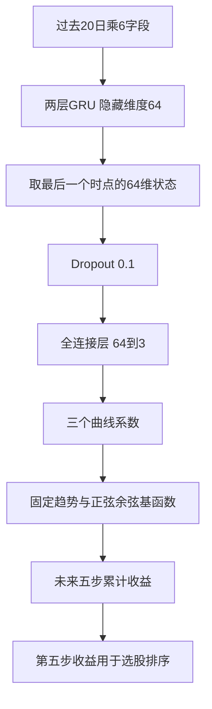
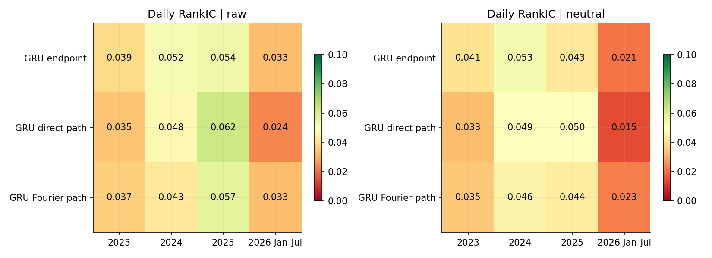
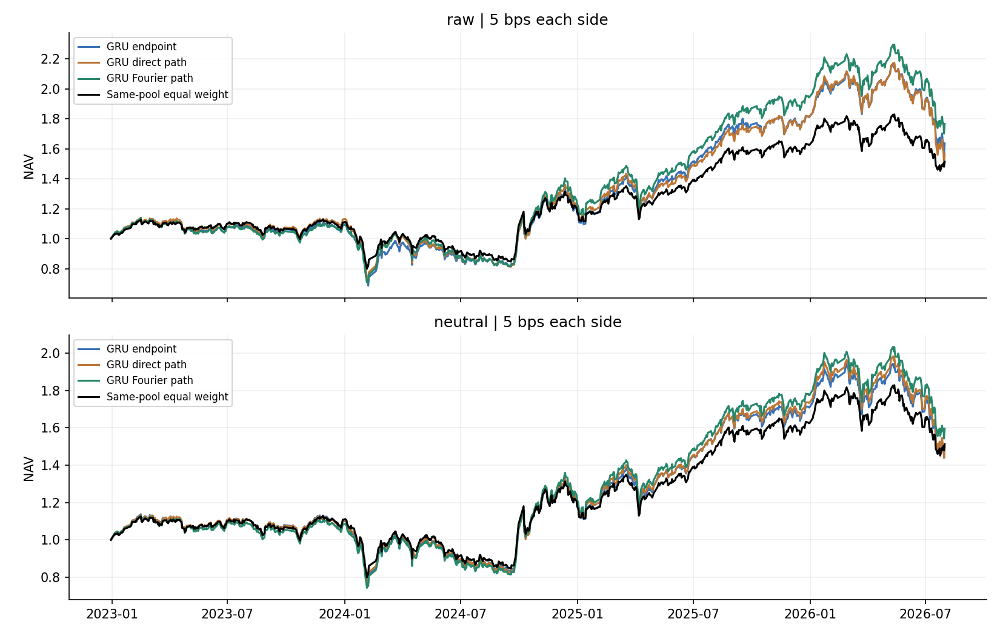
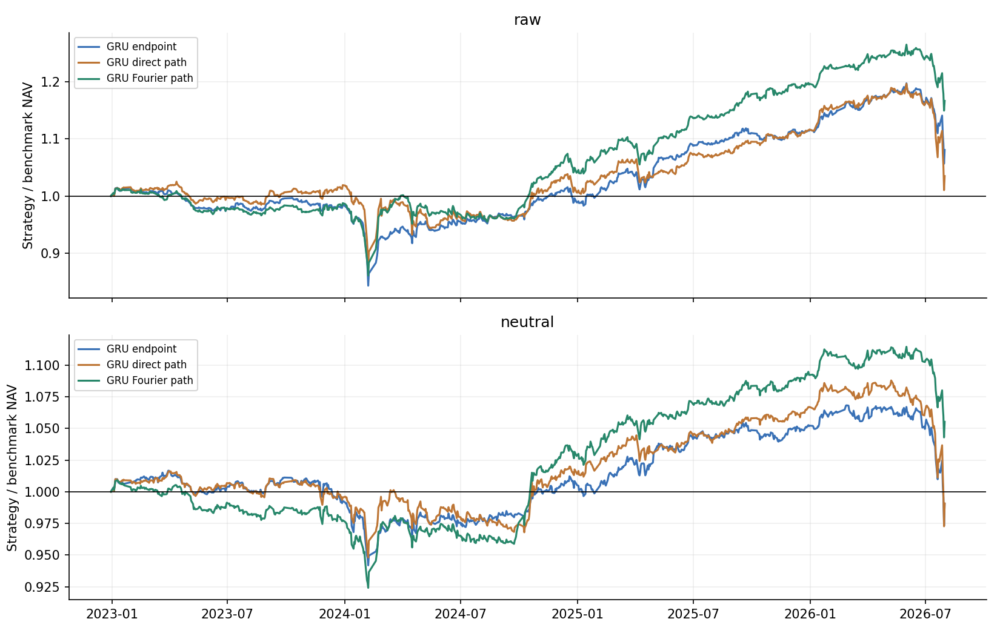
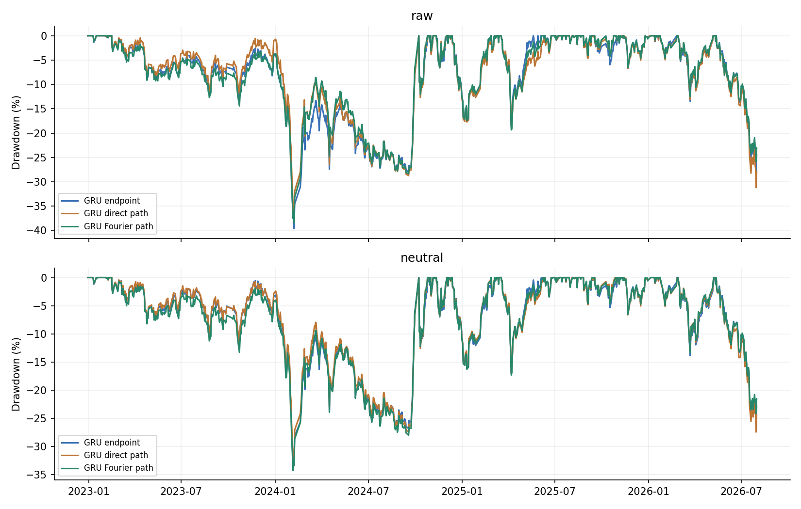
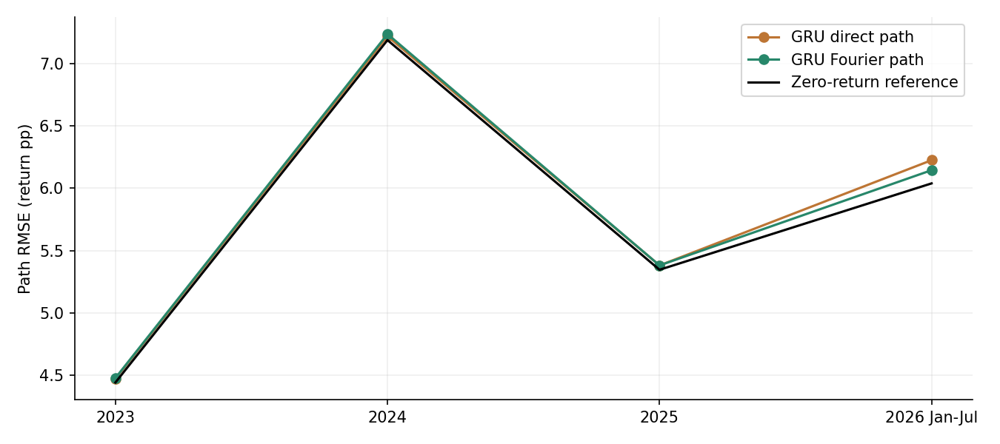
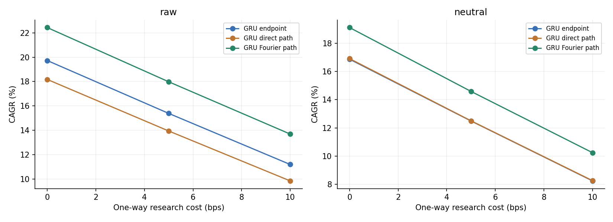
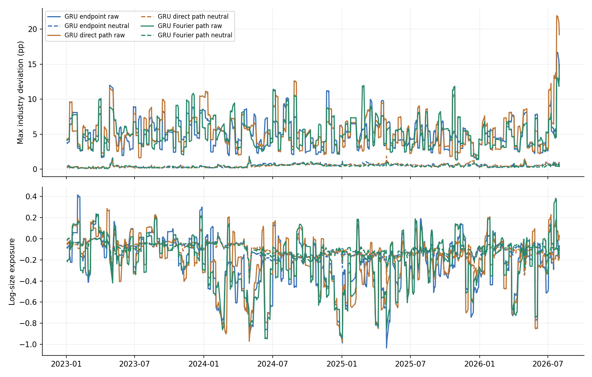
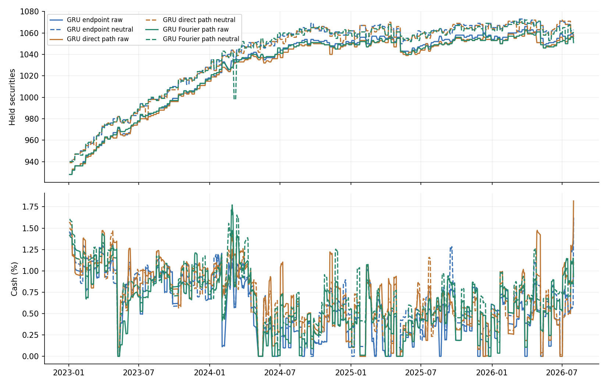

本文记录一个具体问题：能否让神经网络预测组成未来曲线的系数，再用正弦、余弦函数生成收益路径？

本次实现采用“GRU编码历史信息＋固定基函数输出层”。在已完成的年度扩展实验中，傅里叶多步模型的原始组合年化为17.98%，普通多步模型为13.94%，均按单边5bps综合研究成本计算。但傅里叶模型的平均RankIC略低，最大回撤幅度略大。年化改善是本次历史实验的观察，不能直接证明周期被识别，也不能证明鲁棒性提高。

**版本边界**：本文所有成绩对应输入为开盘价、最高价、最低价、收盘价、成交量、成交额的已完成实验。另行讨论的OHLC、VWAP、成交量六字段版本，以及SAMGRU对照，不计入本文成绩。本文不是完整N-BEATS论文复现，也没有通过FFT发现市场主周期。

## 一、预测对象：五步累计收益

设$t$为信号日，模型只能使用截至$t$日收盘已经获得的信息。入场锚点为下一市场交易日$t+1$的开盘。定义第$h$步标签：

$$
r_t(h)=\frac{O^{\mathrm{adj}}_{t+1+h}}{O^{\mathrm{adj}}_{t+1}}-1,
\qquad h=1,2,3,4,5.
$$

其中$O^{\mathrm{adj}}$为原始开盘价乘同日复权因子。

- 第1步：从$t+1$开盘到$t+2$开盘的累计收益。
- 第5步：从$t+1$开盘到$t+6$开盘的累计收益。
- $h=0$是入场锚点，累计收益为0。

这五个数是从同一锚点出发的累计收益，不是五个独立的单日收益。最终选股使用第5步预测；中间四步用于路径监督。本次没有依据预测路径在持有期内择时交易。

## 二、输入与GRU主干

每只股票的输入为最近20个连续市场交易日、每天6个字段，单个样本形状为$20\times6$。

OHLC乘同日复权因子，相对信号日复权收盘价取自然对数；成交量、成交额各自相对20日窗口均值取自然对数。输入均值与尺度复用仅由2013—2020年训练侧搜索样本拟合的冻结统计量，标准化后裁剪至$[-8,8]$。日期和证券代码只用于索引，不作为模型特征。

模型要求20个市场交易日的历史输入有效，不先删缺失日期再把剩余记录拼成“连续20日”。预测候选资格不要求未来收益标签存在；未来缺价、末端标签尚未成熟的观测只从相应评价中排除，不能据此美化组合候选池。



对批量大小$N$，张量依次为：

$$
X\in\mathbb R^{N\times20\times6}
\longrightarrow H\in\mathbb R^{N\times20\times64}
\longrightarrow Z\in\mathbb R^{N\times64}
\longrightarrow C\in\mathbb R^{N\times3}.
$$

三类模型的GRU主干相同，区别在于输出层。

| 模型 | 输出方式 | 监督目标 |
| --- | --- | --- |
| 终点GRU | 64维状态直接映射为1个数 | 第5步累计收益 |
| 普通多步GRU | 64维状态直接映射为5个数 | 五步累计收益 |
| 傅里叶多步GRU | 64维状态映射为3个系数，再生成5个数 | 五步累计收益 |

因此，直接多步与傅里叶多步的比较更接近输出结构对照；终点与多步的比较还包含监督任务的差异。

## 三、三个系数怎样生成五步曲线

本次采用一条线性趋势与一对固定正弦、余弦形状：

$$
f_1(h)=\frac h5,\qquad
f_2(h)=\sin\left(\frac{2\pi h}{10}\right),\qquad
f_3(h)=\cos\left(\frac{2\pi h}{10}\right)-1.
$$

对$h=1,\ldots,5$，每一列做归一化：

$$
d_j=\sqrt{\sum_{h=1}^{5}f_j(h)^2},\qquad
B_{hj}=\frac{f_j(h)}{d_j}.
$$

这样得到固定的$5\times3$矩阵$B$。设网络针对当前股票和信号日输出系数$c_t\in\mathbb R^3$，缩放单位下的预测为：

$$
\widehat{\boldsymbol z}_t=Bc_t.
$$

训练使用一个仅由本折成熟训练样本计算的5日收益RMS尺度$s$，五个期限共用该尺度。因此恢复实际收益单位后：

$$
\widehat{\boldsymbol r}_t=sBc_t.
$$

周期形状参数10和矩阵$B$始终固定；网络只学习每只股票、每个信号日的系数。没有学习频率，没有寻找最强频谱峰，也没有把一组历史拟合系数原封不动地延伸到未来。

由于三个原始基函数在$h=0$都为0，曲线锚定入场时的零累计收益。矩阵秩为3，模型只能表示这个三维函数空间中的五点路径，不能表示任意五点曲线。归一化后的矩阵条件数约22.93；归一化不意味着这些基函数彼此正交。

另一个容易忽略的细节是$f_2(5)=\sin(\pi)=0$：第5步收益由趋势与余弦系数直接决定，正弦系数主要通过中间路径监督影响训练。这个特性来自本次固定基函数选择，不能泛化成所有傅里叶模型的性质。

## 四、代码与端到端训练

输出层的核心实现如下，省略数据读取、日志和设备管理：

```python
class Model(nn.Module):
    def __init__(self, family, basis):
        super().__init__()
        self.family = family
        self.body = nn.GRU(
            6, 64, 2, batch_first=True, dropout=0.1
        )
        self.drop = nn.Dropout(0.1)
        output_dim = {"endpoint": 1, "direct": 5, "fourier": 3}[family]
        self.head = nn.Linear(64, output_dim)
        self.register_buffer("basis", torch.as_tensor(basis, dtype=torch.float32))

    def forward(self, x):
        hidden = self.body(x)[0][:, -1]
        coefficients = self.head(self.drop(hidden))
        if self.family == "fourier":
            return coefficients @ self.basis.T
        return coefficients
```

普通多步与傅里叶多步的损失为：

$$
L=\frac1{5N}\sum_{i=1}^{N}\sum_{h=1}^{5}
\left(\widehat z_i(h)-\frac{r_i(h)}s\right)^2.
$$

反向传播经过固定矩阵$B$，更新系数输出层及GRU参数；$B$注册为buffer，不接受梯度更新。单个样本满足：

$$
\nabla_{c}L=B^\top\nabla_{\widehat{\boldsymbol z}}L.
$$

这也说明输出结构会改变五个期限的梯度组合方式。相同训练轮数下，性能差异可能包含不同的优化速度，不能全部解释为正则化。

| 参数 | 固定配置 |
| --- | --- |
| GRU层数、隐藏维度 | 2层，64维 |
| 层间及输出Dropout | 0.1 |
| 优化器 | AdamW |
| 学习率、weight decay | 0.001、0.0001 |
| 批量大小、训练轮数 | 2048、8轮 |
| 梯度裁剪 | 范数上限1.0 |
| 随机种子 | 20261116 |
| 推理批量 | 4096 |

本轮仅一个随机种子，固定8轮不代表已经充分收敛。目标是原始累计收益经训练侧统一尺度缩放，不做逐日截面z-score；不能把之前使用截面z-score目标的GRU成绩与本轮直接作机制归因。

## 五、按年度扩展训练

训练起点固定为2013年，每年加入上一年历史，从头重训三个模型，预测下一年度。每折训练必须以标签实际退出日为边界；当年末端尚未成熟的收益不能进入该折训练。

| 预测年度 | 训练范围 | 成熟训练样本 | 预测证券日 |
| --- | --- | ---: | ---: |
| 2023 | 2013—2022 | 7,057,105 | 1,177,355 |
| 2024 | 2013—2023 | 8,231,282 | 1,245,228 |
| 2025 | 2013—2024 | 9,474,565 | 1,255,798 |
| 2026年1—7月 | 2013—2025 | 10,727,923 | 726,895 |

三个模型使用相同的成熟完整路径训练行，以及相同的可评分输入。参数不根据2023—2026年的成绩调整，不使用测试年度早停。年末最后交易日的收盘信号可以用于新年首个交易日开盘，这是研究中的年度重训约定，未单独模拟年末训练及部署耗时。

合计完成12个模型。虽然每折训练没有使用未来年度标签，但2023—2026年此前已在整个研究中被查看，不能把这轮历史评价称为全新盲测。

## 六、组合与成本口径

参考回测覆盖2023年首个交易日至2026-07-31，共866个观察交易日。每个情景独立初始资金1亿元，跨年不重置持仓和现金。

- 保留来源覆盖的沪、深、北历史A股，按日动态资格与输入有效性筛选，不按今天的存续名单回填。
- 每5个市场交易日调仓，使用前一交易日收盘后的信号，在下一日开盘参考成交。
- 原始组合选择分数前20%，目标等权，股票仓位99.5%、现金缓冲0.5%，不加杠杆、不做空。
- 中性约束版本先做行业与log市值信号残差化，再约束目标组合相对同池等权基准的行业权重和行业内log市值均值。它不是零市场敞口。
- 单边0、5、10bps各自独立记账；5bps表示买入与卖出均按成交金额的0.05%扣费。
- 共同基准为同候选池、同调仓与执行规则的等权组合，不是官方指数。

三模型、原始与约束两个版本、三档费用，再加三个共同基准，共21个情景。采用独立研究账本调用既有账户函数，不通过交易服务或真实订单簿撮合。年度统计使用上一观察日净值为期初；年化按252个交易日、夏普按零无风险利率计算。

## 七、已观察到的结果

### 1. 预测排序能力

下表为860个有效评价日期上的日截面相关系数均值。5日标签重叠，ICIR和RankICIR是未年化的描述性比值。

| 模型 | 原始IC | 原始RankIC | 原始RankICIR |
| --- | ---: | ---: | ---: |
| 终点GRU | 0.0328 | 0.0462 | 0.4937 |
| 普通多步GRU | 0.0334 | 0.0445 | 0.4456 |
| 傅里叶多步GRU | 0.0339 | 0.0436 | 0.4432 |



傅里叶模型的整体RankIC略低于普通多步模型，并不存在“所有预测指标都更好”的现象。

### 2. 单边5bps下的组合成绩

| 模型 | 组合 | 累计收益 | 年化收益 | 最大回撤 | 夏普 |
| --- | --- | ---: | ---: | ---: | ---: |
| 终点GRU | 原始 | 63.53% | 15.39% | -39.62% | 0.6476 |
| 普通多步GRU | 原始 | 56.60% | 13.94% | -37.61% | 0.5905 |
| 傅里叶多步GRU | 原始 | 76.52% | 17.98% | -38.40% | 0.7211 |
| 终点GRU | 行业/市值约束 | 49.86% | 12.49% | -33.30% | 0.5784 |
| 普通多步GRU | 行业/市值约束 | 49.91% | 12.50% | -32.61% | 0.5737 |
| 傅里叶多步GRU | 行业/市值约束 | 59.66% | 14.59% | -34.27% | 0.6439 |
| 共同等权基准 | 同池基准 | 51.31% | 12.81% | -29.29% | 0.6187 |



傅里叶原始组合的年化比普通多步高约4.04个百分点，但最大回撤幅度也略大。相对共同基准的年化按策略净值除以基准净值计算：傅里叶原始组合为4.59%，不能用17.98%直接减12.81%替代。





### 3. 分年度原始组合累计收益

| 模型 | 2023 | 2024 | 2025 | 2026年1—7月 |
| --- | ---: | ---: | ---: | ---: |
| 终点GRU | 9.07% | 7.01% | 55.55% | -9.93% |
| 普通多步GRU | 12.86% | 5.22% | 52.95% | -13.78% |
| 傅里叶多步GRU | 9.37% | 12.43% | 58.29% | -9.31% |

2023年傅里叶落后，2024、2025及2026年1—7月领先。优势具有年度差异，2026列为七个月区间累计收益，不是全年收益或全年年化。

### 4. 路径误差与成本



图中误差按路径完整的共同样本计算，单位是收益百分点。傅里叶版本并非每年路径误差都更小；两种多步模型各年度的路径RMSE都未低于零收益预测基准。排序和组合收益可以改善，同时点预测误差没有改善，不能将二者视为同一个评价目标。



在零费用下，普通多步与傅里叶原始组合年化分别为18.18%和22.44%；在单边10bps下，分别为9.84%和13.69%。5bps下累计双边换手分别约251.73和254.40倍，因此本轮优势不能解释为傅里叶模型通过少换手节约了费用。





## 八、年化提高是否说明“加噪声更鲁棒”

本次傅里叶模块没有加入随机噪声。它把五步输出限制在三维函数空间，更接近一种结构约束：让网络难以独立追逐每个期限的扰动。

这种约束可能减少部分过拟合，也可能丢掉有效信号。它还改变了梯度组合、输出尺度对应的优化几何及固定8轮下的收敛速度。仅凭一次单种子历史回测，不能判断哪种机制导致了年化差异。

加噪声训练在一定条件下可以产生正则化作用，但“都可能限制过拟合”并不意味着傅里叶输出等同于加噪声。当前事实是：年化更高、平均RankIC略低、最大回撤幅度略大，2023年还落后。我们尚未验证输入小扰动下的稳定性、不同种子的稳定性或新市场阶段的适应性。

有辨别力的后续对照包括：普通五点输出、三系数多项式输出、三系数傅里叶输出，以及普通输出加训练噪声。若不同三维输出都改善，支持“降低自由度”的解释；若傅里叶稳定优于同维其他基函数，才更支持具体基函数形状的适配作用。频率、噪声幅度和其他参数仍只能在训练侧选择。

## 九、核验与结论范围

本轮完成12个模型、21个参考账本、142项已固定产物校验。模型按原推理批次形状重载抽查，预测最大绝对误差为0；独立账本脚本重算逐笔费用、次日执行、现金、市值、最终持仓、净值及年度统计，核验通过。

仍保留以下边界：

1. 历史ST缓存完整性、行业记录原始发布时间尚未完全认证。
2. 公司行动采用复权因子隐含再投资及零碎现金近似，没有完整认证现金分红、税款、配股和退市结算。
3. 开盘参考成交使用了部分执行日日终状态作事后判定，未模拟盘口排队、开盘容量和价格冲击。
4. 0/5/10bps是综合研究费率，未逐项建模真实费税与最低佣金。
5. 单种子、固定8轮及已查看的历史评价区间，不足以建立稳定优势或因果机制。

因此，本轮结果支持继续研究GRU加固定基函数输出，但不构成“发现股票固定周期”“证明加噪声提高鲁棒性”或“可以直接复制实盘净收益”的证据。

## 参考资料

- Oreshkin等：[N-BEATS: Neural basis expansion analysis for interpretable time series forecasting](https://arxiv.org/abs/1905.10437)。本文借鉴固定基函数生成预测的思想，没有复现其完整结构或论文成绩。
- Bishop：[Training with Noise is Equivalent to Tikhonov Regularization](https://www.microsoft.com/en-us/research/wp-content/uploads/2016/02/bishop-tikhonov-nc-95.pdf)。用于区分噪声训练与本次结构约束。
- 实验依据：2026-11-17完成的年度扩展运行，固定数据范围2013-01-01—2026-07-31；模型、逐年度指标、账户核验及图表均来自同一次冻结实验。本文图表为本次实验生成，不是原论文图。
