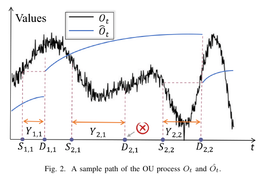
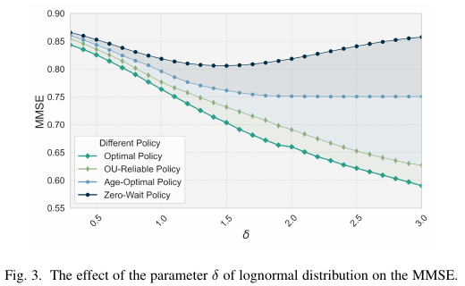
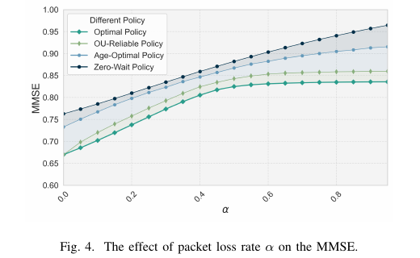
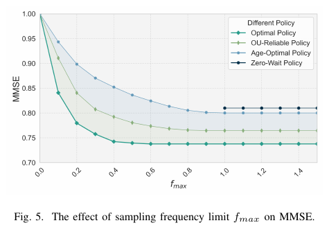
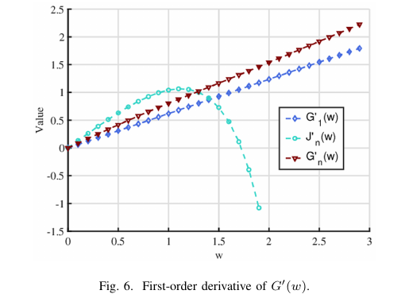
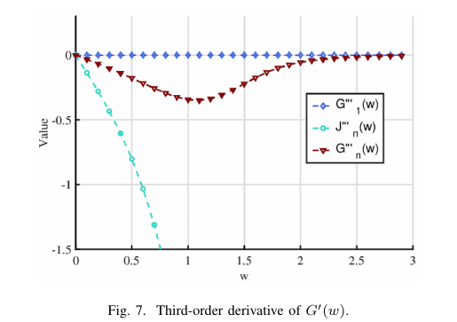

论文：Miao Pan, Jiayu Pan, Rui Chai, Xuhong Zhang, Jianwei Yin，*Sampling the Ornstein Uhlenbeck Process for Remote Estimation over an Unreliable Channel*。

本文按数学学习笔记组织：先定义对象，再陈述命题，随后整理原文的定义、引理和定理，最后给出中文推导。数学基础与补充证明只用中文；原文内容采用英文—中文对照。原文编号保持不变，本笔记的补充编号带章节号。页码指所提供的 10 页 PDF。

原文数学命题按提供版本转录，公式只排版一次，由英文和中文共用。疑似笔误保留并在“注”中解释，不把改写后的正确公式冒充原文。下文称“原文定理”，表示论文如此陈述，不表示本笔记已经补齐其全部证明。

## 第一章 数学预备知识

### 定义 1.1 滤过概率空间与适应过程

设 $(\Omega,\mathcal F,\mathbb P)$ 为概率空间，$(\mathcal F_t)_{t\ge0}$ 为递增的子 $\sigma$ 代数族，即 $s\le t$ 时 $\mathcal F_s\subseteq\mathcal F_t\subseteq\mathcal F$。称 $(\Omega,\mathcal F,(\mathcal F_t),\mathbb P)$ 为滤过概率空间。

本笔记假设滤过满足通常条件：右连续且包含所有零测集。过程 $X=(X_t)_{t\ge0}$ 若每个 $X_t$ 都是 $\mathcal F_t$ 可测的，则称为适应过程。$\mathcal F_t$ 描述时刻 $t$ 已获得的信息。

### 定义 1.2 标准布朗运动

适应过程 $W=(W_t)_{t\ge0}$ 称为相对于 $(\mathcal F_t)$ 的标准布朗运动，若：

1. $W_0=0$ 几乎处处成立；
2. 样本路径几乎处处连续；
3. 对 $0\le s<t$，$W_t-W_s$ 独立于 $\mathcal F_s$；
4. $W_t-W_s\sim\mathcal N(0,t-s)$。

特别地，$\mathbb E[W_t]=0$，$\operatorname{Var}(W_t)=t$。布朗运动是本文 OU 方程的噪声驱动。

### 定义 1.3 Itô 积分与随机微分方程

若 $H$ 是可预测过程，且 $\mathbb E\int_0^T H_s^2ds<\infty$，其 Itô 积分 $\int_0^T H_s\,dW_s$ 可由适当阶梯过程积分在 $L^2$ 中取极限定义，并满足

$$
\mathbb E\left[\int_0^T H_s\,dW_s\right]=0,\qquad
\mathbb E\left[\left(\int_0^T H_s\,dW_s\right)^2\right]=\mathbb E\int_0^T H_s^2ds.
$$

后一个等式称为 **Itô 等距**。随机微分方程 $dX_t=b(X_t)dt+a(X_t)dW_t$ 的含义是积分等式

$$
X_t=X_0+\int_0^t b(X_s)ds+\int_0^t a(X_s)dW_s.
$$

### 定义 1.4 Ornstein–Uhlenbeck 过程

给定 $\theta>0$、$\sigma>0$、$\mu\in\mathbb R$ 和初值 $O_0$，满足

$$
dO_t=\theta(\mu-O_t)dt+\sigma dW_t
$$

的连续适应过程称为 **Ornstein–Uhlenbeck 过程**，简称 **OU 过程**。漂移和扩散系数全局 Lipschitz，因此对适当给定的初值，该方程存在唯一强解。

$\theta$ 为均值回复速率，$\mu$ 为回复水平，$\sigma$ 为扩散系数。“均值回复”描述条件均值的演化，不表示每条样本路径单调趋向 $\mu$。

### 命题 1.5 OU 过程的显式解与转移分布

设 $O_0=x$。则

$$
O_t=\mu+(x-\mu)e^{-\theta t}+\sigma\int_0^t e^{-\theta(t-s)}dW_s,
$$

且

$$
O_t\mid O_0=x\sim\mathcal N\left(\mu+(x-\mu)e^{-\theta t},\frac{\sigma^2}{2\theta}(1-e^{-2\theta t})\right).
$$

**证明。** 对 $e^{\theta t}(O_t-\mu)$ 使用 Itô 公式，漂移抵消，积分后得到显式解。积分核确定，故随机积分为高斯变量；由 Itô 等距，其方差为 $\sigma^2\int_0^t e^{-2\theta(t-s)}ds$。计算积分即得。$\square$

**推论。** $\mathcal N(\mu,\sigma^2/(2\theta))$ 是 OU 过程的不变分布。若以该分布初始化，并使初值独立于未来布朗增量，则过程平稳；确定初值下的 OU 过程一般不从起始时刻就平稳。

### 定义 1.6 停止时刻与首次出界时刻

随机变量 $\tau:\Omega\to[0,\infty]$ 若满足 $\{\tau\le t\}\in\mathcal F_t$ 对所有 $t\ge0$ 成立，则称为停止时刻。定义

$$
\mathcal F_\tau=\{A\in\mathcal F:A\cap\{\tau\le t\}\in\mathcal F_t,\ \forall t\ge0\}.
$$

对连续适应过程 $X$ 和阈值 $v\ge0$，

$$
\tau_v=\inf\{t\ge0:|X_t|\ge v\},\qquad\inf\varnothing=\infty,
$$

是首次离开开区间 $(-v,v)$ 的停止时刻。本文的采样时刻必须满足非预见性，故使用停止时刻建模。

### 命题 1.7 OU 过程的强马尔可夫性

记 $P_t f(x)=\mathbb E_x[f(O_t)]$。对任意几乎处处有限的停止时刻 $\tau$、$t\ge0$ 和有界 Borel 函数 $f$，

$$
\mathbb E[f(O_{\tau+t})\mid\mathcal F_\tau]=P_t f(O_\tau).
$$

这里的滤过须适用于 OU 过程及其驱动噪声，额外引入的信道随机性按独立外部随机性处理。该性质允许在随机采样时刻重新描述未来创新，是周期分解和 Bellman 递推的基础；它本身不自动保证任意控制策略下的各周期独立同分布。

### 定义 1.8 条件均方最优估计

设 $Z\in L^2$，$\mathcal G\subseteq\mathcal F$ 为子 $\sigma$ 代数。称

$$
\widehat Z=\mathbb E[Z\mid\mathcal G]
$$

为基于 $\mathcal G$ 的均方最优估计。

**命题。** 对任意 $U\in L^2(\mathcal G)$，

$$
\mathbb E[(Z-U)^2]=\mathbb E[(Z-\widehat Z)^2]+\mathbb E[(\widehat Z-U)^2].
$$

**证明。** 展开平方；交叉项为零，因为 $\mathbb E[Z-\widehat Z\mid\mathcal G]=0$。故 $\widehat Z$ 唯一地在几乎处处意义下最小化均方误差。$\square$

**注。** 信息集是定义的一部分。对信号感知采样，接收端是否使用“尚无新样本到达”这一事件，可能影响条件期望。本文沿用论文式 (3) 的估计器；不把它无条件推广为任意信息结构下的联合最优估计器。

### 定义 1.9 中心化误差过程

在两次成功更新之间，设论文使用的预测满足 $d\widehat O_t=\theta(\mu-\widehat O_t)dt$。误差 $X_t=O_t-\widehat O_t$ 因而满足

$$
dX_t=-\theta X_tdt+\sigma dW_t.
$$

用 $X_t^w$ 表示从 $X_0=w$ 出发的解，则

$$
X_t^w=e^{-\theta t}w+Z_t,\qquad Z_t=\sigma\int_0^t e^{-\theta(t-s)}dW_s,
$$

$$
\mathbb E_w[(X_t^w)^2]=e^{-2\theta t}w^2+m_\infty(1-e^{-2\theta t}),\qquad m_\infty=\frac{\sigma^2}{2\theta}.
$$

**注。** $X_t^w$ 不能一般地写成 $w+Z_t$。原文后半部分的 $w+O_t$ 若表示 OU 状态，必须进一步明确其“增量”是否依赖 $w$。本笔记的中文推导统一使用 $X_t^w$。

### 定义 1.10 转移半群与无穷小生成元

对中心化 OU 过程定义 $P_t f(w)=\mathbb E_w[f(X_t)]$。若下列极限存在，定义

$$
\mathcal Lf(w)=\lim_{t\downarrow0}\frac{P_t f(w)-f(w)}t.
$$

对足够光滑、满足适当增长条件的 $f$，由 Itô 公式有

$$
\mathcal Lf(w)=\frac{\sigma^2}{2}f''(w)-\theta wf'(w).
$$

对适当可积的停止时刻 $\tau$，经局部化并满足极限交换条件后，Dynkin 公式为

$$
\mathbb E_w[f(X_\tau)]-f(w)=\mathbb E_w\int_0^\tau\mathcal Lf(X_s)ds.
$$

### 定义 1.11 最优停止问题与自由边界

给定运行成本 $c$、停止成本 $G$ 和可容许停止时刻集合 $\mathcal T$，定义价值函数

$$
V(w)=\inf_{\tau\in\mathcal T}\mathbb E_w\left[\int_0^\tau c(X_s)ds+G(X_\tau)\right].
$$

假设立即停止属于 $\mathcal T$，则 $V\le G$。定义继续区 $\mathcal C=\{w:V(w)<G(w)\}$，停止区 $\mathcal S=\{w:V(w)=G(w)\}$，其分界称为自由边界。

在具有足够正则性的经典情形，最小化问题对应

$$
\min\{\mathcal LV+c,\ G-V\}=0.
$$

因此继续区内 $\mathcal LV+c=0$，停止区内 $V=G$。对称阈值形式 $\mathcal C=(-v,v)$ 是需要证明的结构，不能仅由问题的对称性推断。

### 定义 1.12 过度函数与带运行成本的验证

对马尔可夫半群 $(P_t)$，非负可测函数 $h$ 若满足 $P_t h\le h$ 且 $\lim_{t\downarrow0}P_t h=h$，称为 excessive function，常译“过度函数”。对允许取负值的推广，需要另行说明可积性等条件。原文 Definition 1 采用的是简化不等式定义，见第四章。

本问题 $c(w)=w^2-\beta$ 有正有负。验证最优性时通常应保留运行成本，研究

$$
\widetilde V(X_t)+\int_0^t c(X_s)ds
$$

的次鞅性质，或通过势函数变换消去运行成本。不能单凭 $-\widetilde V$ 的形式就忽略累计成本。

### 定义 1.13 几何尝试次数与周期平均成本

设每次传输以概率 $\alpha\in[0,1)$ 独立失败，以概率 $1-\alpha$ 成功。首次成功所需次数 $C$ 满足

$$
\mathbb P(C=k)=(1-\alpha)\alpha^{k-1},\quad k\ge1,\qquad \mathbb E[C]=\frac1{1-\alpha}.
$$

以相邻成功接收时间之间的间隔为周期，记长度为 $L$、误差积分为 $A$。在适当的再生或平稳更新条件与可积性条件下，长期平均成本为 $\mathbb E[A]/\mathbb E[L]$。它一般不同于 $\mathbb E[A/L]$。

### 定义 1.14 特殊函数与基本常数

为阅读原文，记

$$
q=\mathbb E[e^{-2\theta Y}],\quad \gamma=\frac{1-q}{2\theta},\quad m_Y=m_\infty(1-q)=\sigma^2\gamma.
$$

定义 $F(x)=e^{x^2}\int_0^x e^{-u^2}du$。它满足 $F'(x)=1+2xF(x)$、$F(0)=0$。此处 $F$ 并非通常定义的 Dawson 积分。

定义 Pochhammer 符号 $(a)_0=1$、$(a)_k=a(a+1)\cdots(a+k-1)$。在分母参数不取非正整数时，广义超几何函数由相应收敛级数定义：

$$
{}_pF_q(a_1,\ldots,a_p;b_1,\ldots,b_q;z)=\sum_{k=0}^\infty\frac{(a_1)_k\cdots(a_p)_k}{(b_1)_k\cdots(b_q)_k}\frac{z^k}{k!}.
$$

本文用到 ${}_2F_2(1,1;3/2,2;z)$，其级数对所有有限 $z$ 收敛。

## 第二章 背景与引言 原文中英对照

### 研究问题

**原文节选 · Abstract，第 1 页**

> We study a sampling problem, where the sampler chooses a time to take a sample of the Ornstein Uhlenbeck (OU) process and transmits the sample to a remote estimator over an unreliable channel. The goal is to design these sampling times to minimize the long-term average mean square estimation error (MSE).

**中文译文**

我们研究一个采样问题：采样器选择某个时刻对 OU 过程取样，再通过不可靠信道将样本传给远端估计器。目标是设计这些采样时刻，使长期平均均方估计误差最小。

**理解**：优化变量是“何时取样”。发送端能连续观察信号，但不应把每一刻的观测都发送出去。接收端面对的是有延迟、会丢失的样本。

### 摘要里的困难和条件

**原文节选 · Abstract，第 1 页**

> First, the OU process includes an additional drift term, complicating the reward function. Then, under an unreliable channel, computing the action value functions needs iterations. These make it hard to compute an optimal value function via value iteration. Moreover, the drift term makes the third derivative of the reward function nonlinear, making it complicated to validate the optimality. Despite the challenges, through thorough calculations and a convexity assumption, we are still able to obtain an optimal sampling policy that remains a simple threshold structure with low complexity.

**中文译文**

首先，OU 过程多了漂移项，使收益函数变复杂。其次，在不可靠信道下，动作价值函数需要迭代计算，因而难以通过价值迭代求出最优价值函数。此外，漂移项使收益函数的三阶导数呈现非线性，增加了最优性验证的难度。尽管如此，通过详细计算并引入一个凸性假设，我们仍能获得保持简单阈值结构、且计算复杂度较低的最优采样策略。

**理解**：两种困难叠加：OU 改变状态演化；丢包让“一次发出就结束”变成“失败后继续决策”。摘要已经出现 **a convexity assumption**，说明不能把后文所有最优性表述理解为无条件的完整证明。

### 为什么需要研究采样时刻

**原文 · Introduction，第 1 页**

> IoT systems, such as self-driving clusters, telemedicine networks, smart factories, etc., often involve information sampling, remote transmission, and destination-side estimation. For example, in an autonomous driving cluster, information such as vehicle position, speed, and acceleration, changes over time [1]; In telemedicine networks, information such as images during surgery, and the position and angle of instruments, also change over time. However, transmitting all the information remotely to the destination is impossible, because of the limited channel capacity and the limited sampling rate constraint [2]–[4]. Therefore, how to cleverly take samples so that the destination receives the message as accurately as possible (i.e., the real-time requirements) is crucial.

**中文译文**

自动驾驶车群、远程医疗网络、智能工厂等物联网系统通常涉及信息采样、远端传输和接收端估计。例如，车群中车辆的位置、速度、加速度随时间变化；远程医疗中的手术图像、器械位置和角度也随时间变化。然而，受限于信道容量和采样率，无法把所有信息都实时传到目的端。因此，如何巧妙地选择采样，使目的端尽可能准确地掌握信息，是一个关键问题。

**理解**：采得更勤有时更费资源，并可能在长传输期间占据信道；等待有时能够把发送机会留给更有价值的新状态。

### 信息新鲜不等于估计准确

**原文节选 · Introduction，第 1 页**

> These metrics focus on freshness and correctness but fail to fully capture the stochastic evolution of real-time signals, especially in a continuous-time system. In particular, AoI-optimal policies do not necessarily minimize estimation error that quantifies the difference between the received signal and the real-time signal [8]. A more precise metric is Minimum Mean Square Estimation Error (MMSE) [4].

**中文译文**

这些指标关注信息的新鲜程度和正确性，却不能完全刻画实时信号的随机演化，尤其是在连续时间系统中。特别地，AoI 最优策略不一定使估计误差最小；估计误差衡量接收信息与实时信号之间的差异。更精细的指标是最小均方估计误差。

**理解**：信息年龄 $\Delta_t=t-S_{\rm latest}$ 只问“最近的信息有多老”。MSE 还问“老信息现在还能预测得多准”。同样过了 1 秒，信号可能几乎没变，也可能偏离很远；信号感知策略能够利用这个差别。

### 不可靠信道的研究缺口

**原文节选 · Introduction，第 1 页**

> For instance, [12] considers packet losses in transmission but assumes that the sampling policy is signal-independent, thereby decoupling sampling decisions from the stochastic dynamics of the underlying process. This significantly limits its ability to capture real-time signal behavior.

**中文译文**

例如，文献 [12] 考虑传输中的丢包，但假设采样策略与信号无关，从而把采样决策与底层过程的随机动态分离开来。这明显限制了策略捕捉实时信号行为的能力。

**理解**：作者要把“信号感知”与“传输不可靠”放进同一个模型，同时把信号从 Wiener 过程推广为 OU 过程。

### 实际决策流程

**原文 · Introduction，第 2 页**

> Specifically, the sampler at the transmitter (edge) chooses a time to sample the new signal after the transmission channel becomes idle. The sampled signal is transmitted through an unreliable channel with a random delay. At the destination, the estimator estimates the value of the real-time signal by evaluating the received samples and sends an acknowledgment to the sampler. Our goal is to minimize the long-term average MMSE by designing an optimal sampling policy.

**中文译文**

具体而言，发送端即边缘端的采样器在信道变为空闲后，选择对新信号进行采样的时刻。样本经过随机时延，通过不可靠信道传输。接收端利用收到的样本估计实时信号，并向采样器发送确认信息。我们的目标是设计最优采样策略，使长期平均 MMSE 最小。

**理解**：反馈让发送端知道接收端最后成功拿到哪个样本，因此发送端可以同步计算接收端正在使用的估计，进而知道当前实际误差。

### 作者的解题路线

**原文节选 · Introduction，第 2 页**

> We first transform the problem into an optimal stopping problem (iterative formulation). Then, using stochastic integral techniques and properties of OU process, we express the optimal value function iteratively. Secondly, we solve for the threshold of the sampling policy by employing Shiryaev’s free-boundary method [13], [14]. Third, we rigorously prove that our sampling policy is globally optimal using excessive function. We also establish that the iterative problem formulation converges linearly to the final optimal solution.

**中文译文**

我们先把问题转化为具有迭代形式的最优停止问题。随后利用随机积分技术和 OU 过程性质，递推表示最优价值函数。接着使用 Shiryaev 的自由边界方法求出采样策略阈值，再通过过度函数证明采样策略的全局最优性，同时建立迭代问题向最终最优解线性收敛的结果。

**理解**：这段是作者宣称的证明路线。第 VI 节实际保留了证明缺口，因此阅读时把它理解为“目标路线”，不要先假设每一环已经完成。

## 第三章 数学模型与价值函数

### 定义 3.1 采样与传输时间

$S_{i,j}$ 表示第 $i$ 个成功更新周期中的第 $j$ 次采样时间；$Y_{i,j}$ 为传输时延，$D_{i,j}=S_{i,j}+Y_{i,j}$ 为传输结束与反馈时间。$C_i$ 表示该周期首次成功的尝试编号。设 $D_{i,0}=D_{i-1,C_{i-1}}$，等待时间为 $\tau_{i,j}=S_{i,j}-D_{i,j-1}\ge0$。

采样时刻对发送端信息适应，不能预知未来噪声、未来时延或未来传输结果。时延独立同分布，失败事件独立同分布；以下补充推导采用信道随机性与信号噪声相互独立的模型。每次失败后重新采集新样本，不持续重发同一个旧样本。

**原文，第 2 页：**

> Given that outdated samples have diminished utility, the source always generates and transmits a freshly sampled observation following each feedback, regardless of whether the previous attempt was successful or not.

**中文：** 由于过时样本的用途减弱，无论上次尝试成功与否，发送端都会在反馈之后生成并发送新采集的观测。

### 定义 3.2 估计器及目标泛函

论文式 (3) 使用最近成功样本及时间戳构造

$$
\widehat O_t=\mu+(O_{S_{i,C_i}}-\mu)e^{-\theta(t-S_{i,C_i})}.
$$

原文优化目标和约束为

$$
\mathrm{mse}_{\mathrm{opt}}=\inf_{\pi\in\Pi}\limsup_{T\to\infty}\frac1T\mathbb E\int_0^T(O_t-\widehat O_t)^2dt,\tag{5}
$$

$$
\liminf_{i\to\infty}\frac1i\mathbb E[S_{i,C_i}]\ge\frac1{f_{\max}}.\tag{6}
$$

**原文，第 3 页：**

> For notational convenience, let τ_{i,j} = S_{i,j} − D_{i,j−1} denote the waiting time before the next sampling. Hence, determining the optimal sampling time S_{i,j} is equivalent to choosing an optimal stopping time τ_{i,j}.

**中文：** 为方便记号，令 $\tau_{i,j}=S_{i,j}-D_{i,j-1}$ 表示下一次采样前的等待时间。因此，确定最优采样时刻等价于选择最优停止时刻。

**注。** 式 (6) 的索引按成功更新计数，Theorem 3 的约束却具有全部采样尝试的频率形式。两种口径的区别见附录 F。本文不在转录时把二者悄悄合并。

### 定义 3.3 周期成本与参数化价值

记 $D_0$、$D_C$ 为相邻两次成功接收时间，$L=D_C-D_0$，$A=\int_{D_0}^{D_C}(O_t-\widehat O_t)^2dt$。原文式 (9)–(10) 为

$$
\mathrm{mse}_{\mathrm{opt}}=\inf_\pi\frac{\mathbb E[A]}{\mathbb E[L]},\tag{9}
$$

$$
J(w,\beta)=\inf_\pi\mathbb E[A-\beta L\mid O_{D_0}-\widehat O_{D_0}=w].\tag{10}
$$

这里 $w$ 是当前误差，$\beta$ 是参数。周期平均表达需要更新理论的适用条件。

### 定义 3.4 真正价值 候选价值与立即发送成本

本笔记用 $V_n$ 表示递推最优停止问题的真正价值，用 $\widetilde J_n$ 表示通过自由边界构造的候选。原文通常均写成 $J_n$；作证明时必须分开。

固定 $\beta$，设 $V_0=0$，定义

$$
h_\beta(w)=\mathbb E_w\int_0^Y((X_t^w)^2-\beta)dt,
$$

$$
G_n(w)=h_\beta(w)+\alpha\mathbb E_w[V_{n-1}(X_Y^w)],
$$

$$
V_n(w)=\inf_\tau\mathbb E_w\left[\int_0^\tau((X_t^w)^2-\beta)dt+G_n(X_\tau^w)\right].
$$

这是规范 OU 转移记号下的补充定义，不能视作原文式 (11) 的逐字转录。$G_n$ 的含义是现在立即发送、失败后继续优化，而非今后永远零等待。立即停止可行，因此真正价值必有 $V_n\le G_n$；验证工作则需证明候选 $\widetilde J_n$ 满足相应不等式并等于 $V_n$。

**原文，第 6 页：**

> G_n(w) means that in the first transmission we use the zero-wait policy, and the subsequent transmissions use the optimal policy.

**中文：** $G_n(w)$ 表示第一次传输采用零等待策略，而后续传输采用最优策略。

## 第四章 原文定义 定理与引理

本章集中保存论文所有带 Definition、Lemma、Theorem、Corollary 编号的命题。英文陈述与中文译文共享其后的数学表达；带疑点的原式仍按原样记录。

### 原文 Lemma 1 参数化问题的零点 第 4 页

**English**

> (a) mse_opt < β if and only if E[J(O_Y, β)] < 0.
>
> (b) mse_opt > β if and only if E[J(O_Y, β)] > 0.
>
> (c) mse_opt = β if and only if E[J(O_Y, β)] = 0. When mse_opt = β, the solutions to (9) and (10) are identical.

**中文译文**

(a) 最优 MSE 小于 $\beta$，当且仅当 $\mathbb E[J(O_Y,\beta)]<0$；(b) 最优 MSE 大于 $\beta$，当且仅当该期望大于零；(c) 二者相等，当且仅当该期望为零。相等时，问题 (9) 与 (10) 的最优解相同。

**对象与作用。** 这里对成功接收后的随机初始误差求期望，并非令初始误差为零。引理使长期平均成本问题转化为外层关于 $\beta$ 的求根问题。原文未展开证明；条件与证明思路见附录 B。

### 原文 Theorem 1 阈值停止时刻 第 5 页

**English**

> The sequence of optimal waiting times to problem (11) is given as follows:
>
> v_n satisfies the following equation:
>
> where F(x) and G′_n(w, β) are defined as follow:

**中文译文**

问题 (11) 的最优等待时间序列由式 (13) 给出；阈值 $v_n$ 满足式 (14)，其中函数 $F$ 和 $G_n'$ 分别由式 (15)、(16) 定义。

$$
\tau_n=\inf_t\{t\ge0:|w+O_t|\ge v_n\}.\tag{13}
$$

$$
G_n'(v_n,\beta)=\frac{v_n}{\theta}-\left(\frac{\sigma}{\theta^{3/2}}-\frac{2\beta}{\sigma\sqrt\theta}\right)F\left(\frac{\sqrt\theta}{\sigma}v_n\right).\tag{14}
$$

$$
F(x)=e^{x^2}\int_0^x e^{-t^2}dt.\tag{15}
$$

$$
\begin{aligned}
G_n'(w,\beta)=2\gamma w+\alpha\mathbb E\big[&G_{n-1}'(w+O_Y,\beta)\mathbf1_{\{|w+O_Y|\ge v_{n-1}\}}\\
&+J_n'(v_{n-1}+O_Y,\beta)\mathbf1_{\{|w+O_Y|<v_{n-1}\}}\big].
\end{aligned}\tag{16}
$$

**对象与作用。** 固定 $\beta$，先从上一轮函数构造当前立即发送成本，再由导数贴合求边界。阈值形式将连续状态控制规则归结为一个数。

**注。** 式 (16) 的 $J_n'$、$v_{n-1}+O_Y$ 按原文保留；递推下标、自变量和 OU 转移衰减因子均需核对。规范求导公式在附录 C，式 (14) 的 ODE 推导在附录 D。该定理的全局验证依赖后面的 Lemma 5–6，不能仅凭边界等式完成。

### 原文 Theorem 2 最优平均成本 第 5 页

**English**

> The optimal value β = mse_opt is the root of:
>
> where J(O_Y, β) = lim J_n(w, β) is ...

**中文译文**

最优值 $\beta=\mathrm{mse}_{\mathrm{opt}}$ 是式 (17) 的根，其中价值函数通过式 (18) 递推并取极限。

$$
\mathbb E[J(O_Y,\beta)]=0.\tag{17}
$$

$$
J_n(w,\beta)=g(w,v_n,\beta)+\alpha\mathbb E[J_{n-1}(\max\{|w|,v_n\}+O_Y)].\tag{18}
$$

**注。** 原文把极限左侧写为 $J(O_Y,\beta)$，右侧仍保留自变量 $w$，式 (18) 的续项省略了 $\beta$，本处保留其结构。严格书写应先定义 $J(w,\beta)=\lim_nJ_n(w,\beta)$，再代入随机初值。OU 状态转移仍须按附录 C 核对。

### 原文 Corollary 1 零等待声明 第 5 页

**English**

> When α > (mse_∞ − mse_Y)/mse_Y, for all n > 1, there is v_n = 0.

**中文译文**

若 $\alpha>(m_\infty-m_Y)/m_Y$，则对所有 $n>1$ 有 $v_n=0$。

**等价条件。** 当 $m_Y>0$ 时，条件为 $\alpha>q/(1-q)$。因为 $\alpha<1$，要有可行的严格不等式区间，必须 $q<1/2$。

**证明状态。** 此为作者声明，依赖其后最优性论证；不从 OU 方差有上界这一事实直接推出。本文先记录，不展开新的补证或反例研究。

### 原文 Lemma 2 阈值等待的矩 第 6 页

**English**

> Let τ ≥ 0 be a waiting time of the OU process O_t with E[τ] < ∞, then ...
>
> where γ = (1/(2θ))E[1 − e^(−2θY)], R_1(w) = ... and R_2(w) = ... .

**中文译文**

设 $\tau\ge0$ 为 OU 过程的等待时间且 $\mathbb E[\tau]<\infty$。原文给出以下等待时间及误差积分公式，并定义 $\gamma,R_1,R_2$：

$$
\mathbb E[\tau+Y]=\mathbb E[\max\{R_1(v)-R_1(w),0\}]+\mathbb E[Y].\tag{19}
$$

$$
\begin{aligned}
\mathbb E\int_0^{\tau+Y}(O_t-\widehat O_t)^2dt
={}&\mathbb E[\max\{R_2(v)-R_2(w),0\}]\\
&+m_\infty(\mathbb E[Y]-\gamma)+\gamma\mathbb E[\max\{v^2,w^2\}].
\end{aligned}\tag{20}
$$

$$
R_1(w)=\frac{w^2}{\sigma^2}{}_2F_2\left(1,1;\frac32,2;\frac{\theta w^2}{\sigma^2}\right),
$$

$$
R_2(w)=-\frac{w^2}{2\theta}+\frac{w^2}{2\theta}{}_2F_2\left(1,1;\frac32,2;\frac{\theta w^2}{\sigma^2}\right).
$$

**假设说明。** 含阈值 $v$ 的等式应针对首次出界时间 $\tau_v$，不能按引理开头字面用于任意有限均值等待时间。固定初值 $w$ 时外层关于 $w$ 的期望可去掉；随机初值时应明确其分布。附录 E 从生成元方程给出中文推导。

### 原文 Lemma 3 单阶段成本及导数 第 6 页

**English（代数式列于下方）**

> (i) When |w| ≥ v, g(w, v, β) is ... . When |w| < v, g(w, v, β) is ... , where R(w) = ... .
>
> (ii) When |w| ≥ v, g′(w, v, β) is 2γw. When |w| < v, g(w, v, β) is ... . In addition, g′(w, v_n, β) is continuous.

**中文译文**

(i) $g$ 根据 $|w|\ge v$ 与 $|w|<v$ 分段表示。(ii) 区间外导数为 $2\gamma w$；原文还给出区间内的表达，并声称 $g'(w,v_n,\beta)$ 连续。

令 $K_\beta=m_\infty(\mathbb E[Y]-\gamma)-\beta\mathbb E[Y]$，这是为节省重复而引入的记号。原文 (i) 的代数式等价于

$$
g(w,v,\beta)=\begin{cases}
\gamma w^2+K_\beta,&|w|\ge v,\\
\dfrac{w^2}{2\theta}-R(w)-\dfrac{qv^2}{2\theta}+R(v)+K_\beta,&|w|<v,
\end{cases}
$$

$$
R(w)=\left(\frac1{2\theta}-\frac\beta{\sigma^2}\right){}_2F_2\left(1,1;\frac32,2;\frac{\theta w^2}{\sigma^2}\right)w^2.
$$

原文 (ii) 在 $|w|<v$ 时逐字所指的是

$$
g(w,v,\beta)=\frac v\theta-\left(\frac\sigma{\theta^{3/2}}-\frac{2\beta}{\sigma\sqrt\theta}\right)F\left(\frac{\sqrt\theta}{\sigma}v\right).
$$

**注。** 最后一式中的 $g$ 而非 $g'$、$v$ 而非 $w$，均来自原文。由 (i) 直接求导，正确的区间内导数应是附录 D 的 $p(w)$。此外，总价值的光滑贴合不意味着单阶段 $g$ 对任意迭代阈值都单独光滑。这一引理的陈述需要校订，不能照字面背诵。

### 原文 Lemma 4 价值函数导数 第 6 页

**English（公式共用）**

> For all any n = 1, 2, · · ·, if |w| < v_n, then ... ; if |w| > v_n, then ... , where G_0(w) = 0 and G(w) is G_n(w) ≜ ... .

**中文译文**

对任意 $n\ge1$，原文根据 $|w|<v_n$ 与 $|w|>v_n$ 给出以下导数，并定义 $G_0=0$ 及立即发送成本 $G_n$：

$$
J_n'(w)=\frac{v_n}{\theta}-\left(\frac\sigma{\theta^{3/2}}-\frac{2\beta}{\sigma\sqrt\theta}\right)F\left(\frac{\sqrt\theta}{\sigma}v_n\right),\quad |w|<v_n,
$$

$$
J_n'(w)=G_n'(w)=2\gamma w+\alpha\mathbb E[J_{n-1}'(w+O_Y)],\quad |w|>v_n,
$$

$$
G_n(w)=g(w,0,\beta)+\alpha\mathbb E[J_{n-1}(w+O_Y)].
$$

**注。** 继续区导数原文写成与 $w$ 无关的表达，含 $v_n$。从式 (24) 求解应得到 $p(w)$，只有在边界求值时才代入 $v_n$。续项求导在规范 OU 状态下还会出现 $e^{-\theta Y}$ 因子。中文推导见附录 C–D。

### 原文 Theorem 3 采样率约束 第 6 页

**English**

> If the following condition (21) is satisfied, the constrained problem (5)(6) is solved by Theorem 1:
>
> where l_0(w, β) = 0, and ...
>
> Otherwise, if (21) is not satisfied, then (14) is still the optimal solution, but β is the root of ... .

**中文译文**

如果条件 (21) 满足，则带约束的问题仍由 Theorem 1 的策略解决。其中 $l_0=0$，$l_n$ 按式 (22) 递推。否则仍使用式 (14) 确定阈值，但 $\beta$ 改为式 (23) 的根。

$$
\mathbb E\left[\lim_{n\to\infty}l_n(w,\beta)\right]\ge\frac1{f_{\max}(1-\alpha)}.\tag{21}
$$

$$
\begin{aligned}
l_n(w,\beta)={}&\max\{R_1(v_n)-R_1(w),0\}+\mathbb E[Y]\\
&+\alpha\mathbb E[l_{n-1}(\max\{|w|,v_n\}+O_Y,\beta)].
\end{aligned}\tag{22}
$$

$$
\mathbb E\left[\lim_{n\to\infty}l_n(w,\beta)\right]=\frac1{f_{\max}(1-\alpha)}.\tag{23}
$$

**对象与作用。** $l_n$ 为相应策略下的期望剩余周期长度。无约束策略已满足限制时不改变策略；限制生效时调节参数使周期长度达到要求。外层期望的初值分布、式 (6) 与式 (21) 的计数口径，以及状态转移需统一。约束生效时 $\beta$ 一般不再等于最终最优 MSE，见附录 F。

### 原文 Definition 1 过度函数 第 8 页

**English**

> A function h(w) is excessive if E[h(w + O_t)] ≤ h(w) for all t ≥ 0 and w ∈ R.

**中文译文**

若对所有 $t\ge0$ 和 $w\in\mathbb R$ 有 $\mathbb E[h(w+O_t)]\le h(w)$，则称函数 $h$ 为过度函数。

**注。** 这是原文简化定义。规范半群写法与附加条件见定义 1.12；原文 $w+O_t$ 还需核对状态意义。对有运行成本的最优停止，必须明确过度性作用于哪一个经过变换的价值函数。

### 原文 Lemma 5 最优性验证的一部分 第 8 页

**English**

> The negative value function −J_n(w) is excessive when α is less then E[e^(−2θY)] for any w ∈ R and n. Especially when α > (mse_∞ − mse_Y)/mse_Y, the zero-wait policy is best.

**中文译文**

当 $\alpha<q$ 时，对任意状态 $w$ 与迭代次数 $n$，负价值函数 $-J_n$ 为过度函数。特别地，当 $\alpha>(m_\infty-m_Y)/m_Y$ 时，零等待策略最优。

**原文后续说明：**

> Although we did not prove the Lemme 5 when α belongs to (E[e^(−2θY)], (mse_∞ − mse_Y)/mse_Y), that segment of the interval is a very small part.

**中文：** 作者说明，没有证明 $\alpha\in(q,q/(1-q))$ 时的引理，并认为该区间较小。

**证明状态。** 原文明确承认该区间的缺口；实际还应与 $[0,1)$ 取交集。区间的相对大小取决于 $\theta Y$ 的分布。只记录这个事实，不在此展开补证。带运行成本的验证框架见附录 G。

### 原文 Lemma 6 候选价值与停止成本 第 8–9 页

**English**

> We have J_n(w) ≤ G_n(w) for any w ∈ R and the iteration number n = 1, 2, .... Especially when α > (mse_∞ − mse_Y)/mse_Y, J_n(w) equals to G_n(w) for n > 1.

**中文译文**

对任意 $w\in\mathbb R$、$n\ge1$，有 $J_n(w)\le G_n(w)$。特别地，当 $\alpha>(m_\infty-m_Y)/m_Y$ 时，对 $n>1$ 有 $J_n(w)=G_n(w)$。

**命题的数学含义。** 验证工作需要比较自由边界候选 $\widetilde J_n$ 与 $G_n$。如果直接把 $J_n$ 当成已经定义好的最优值，则不等式由立即停止可行自动得到，不能据此证明候选最优。

若候选为偶函数、边界价值匹配，并且在 $0\le w<v_n$ 上有 $\widetilde J_n'(w)\ge G_n'(w)$，则

$$
G_n(w)-\widetilde J_n(w)=\int_w^{v_n}[\widetilde J_n'(u)-G_n'(u)]du\ge0.
$$

这是原文导数比较路线的逻辑，但并未证明导数序对所有参数成立。

**原文，第 9 页：**

> Although this is only one example, we have not found a violation through extensive experimentation. Therefore we are convinced of the correctness of Lemma 6.

**中文：** 尽管这里只展示一个例子，作者表示在大量实验中未找到违反结论的情况，因此相信 Lemma 6 正确。

**证明状态。** 一般情形在所提供版本中以数值支持为主；后续可以向老师核对，但本轮不预先把它确定为研究题目。

### 原文 Lemma 7 压缩性与价值迭代 第 9 页

**English**

> (i) The mapping T satisfies the contraction mapping property, which is ... and ρ < 1.
>
> (ii) J(w) = T^∞J_0(w) is the unique solution to the Bellman equation (47). More specifically, ... .

**中文译文**

(i) 映射 $T$ 满足以下压缩相关估计，且 $\rho<1$。(ii) $J=T^\infty J_0$ 为 Bellman 方程 (47) 的唯一解，并满足所列误差关系。

原文两条不等式为

$$
\|T^{n+1}J_0(w)-T^nJ_0(w)\|\le\rho^n\|TJ_0(w)\|,
$$

$$
\|T^{n+1}J_0(w)-J(w)\|\le\rho^n\|T^nJ_0(w)-J(w)\|.
$$

**注。** 原文未给出范数所依赖的函数空间，本文件也没有式 (47)。通常单步收缩估计的因子为 $\rho$，不是 $\rho^n$；此处保留原式并标记核对。有限迭代价值收敛与阈值收敛是不同命题，后者还需边界根的稳定性。标准压缩定理的可用形式见附录 H。

## 第五章 定理之间的逻辑关系

### 5.1 构造候选

固定 $\beta$ 和上一轮价值函数，构造 $G_n$。原文第 8 页给出

$$
\mathcal L\widetilde J_n(w)+w^2-\beta=0,\quad |w|<v_n,\tag{24}
$$

$$
\widetilde J_n(w)=G_n(w),\quad |w|\ge v_n,\tag{25}
$$

$$
\widetilde J_n'(\pm v_n)=G_n'(\pm v_n).\tag{26}
$$

这里特意添加波浪号表示候选。式 (24) 是继续区方程，式 (25) 是价值匹配，式 (26) 是光滑贴合。解它们可得到候选阈值及 Theorem 1 的边界方程。

**原文：**

> Since this method can only give the necessary conditions for the optimal policy, we still need to prove the optimality of the sampling policy.

**中文：** 由于该方法只能给出最优策略的必要条件，仍需证明策略最优性。

### 5.2 验证候选

应证明 $\widetilde J_n\le G_n$，并在合适意义下证明 $\mathcal L\widetilde J_n+w^2-\beta\ge0$，再验证所用停止时间的可积性和极限交换。Lemma 5–6 承担这一环节；补充验证定理见附录 G。

### 5.3 取迭代极限并选择参数

Lemma 7 试图控制迭代误差；Theorem 2 和 Lemma 1 用零点条件确定无约束问题中的 $\beta$。Theorem 3 将其延伸到采样率受限情形。

**算法 1 的数学结构：** 外层在 $[m_Y,m_\infty]$ 二分 $\beta$，内层迭代价值与边界。净成本为负时下调上界，为正时上调下界。

**算法 2 的数学结构：** 约束生效时改解平均周期长度等于给定目标的方程。原文二分方向需要结合周期长度关于 $\beta$ 的单调性核对，不宜直接照抄。

### 5.4 证明状态索引

| 原文命题 | 在所提供 PDF 中的情况 |
| --- | --- |
| Lemma 1 | 未展开证明；可用分式优化逻辑解释 |
| Lemma 2 | 归因于 OU 性质，未展开；应限定阈值停止时间 |
| Lemma 3–4 | 代数计算未展开，若干导数记号和转移表达需核对 |
| Lemma 5 | 明确承认部分参数区间未证明 |
| Lemma 6 | 一般情况主要由导数图和数值实验支持 |
| Lemma 7 | 压缩空间、范数与证明未展开，交叉引用需核对 |

这里的“未展开”不等于“数学上不存在证明”；明确承认未证明与省略标准计算也应区别对待。

## 第六章 实验与结论 原文中英对照

### 随机时延模型

**原文 · V-A，第 7 页**

> For all simulations, we model the random transmission delay Y using a normalized lognormal distribution of the form e^{δX}/E[e^{δX}], where X is a standard normal random variable. This choice reflects a typical heavy-tailed distribution, consistent with prior works [2]–[4]. The parameter δ controls the dispersion: larger values of δ concentrate the distribution near zero while extending the tail, thus modeling increased variability in transmission delay.

**中文译文**

在全部仿真中，我们使用归一化的对数正态分布 $Y=e^{\delta X}/\mathbb E[e^{\delta X}]$ 建模随机传输时延，其中 $X$ 是标准正态随机变量。这是与既有工作一致的典型重尾分布。参数 $\delta$ 控制离散程度：$\delta$ 越大，更多概率集中到零附近，同时右尾更长，从而描述时延波动的增大。

**理解**：因为 $\mathbb E[e^{\delta X}]=e^{\delta^2/2}$，所以 $Y=e^{\delta X-\delta^2/2}$ 且均值固定为 1。改变 $\delta$ 是改变波动性，不是直接增加平均传输时间。

### 图 3 时延越不稳定会怎样

**原文节选 · V-B，第 7 页**

> As δ increases, indicating heavier-tailed delay distributions, all policies—except the zero-wait policy—exhibit decreasing MMSE. This trend aligns with the theoretical upper bound of MMSE for the OU process, which is σ²/(2θ) = 1.

**中文译文**

随着 $\delta$ 增大、时延分布的尾部变得更重，除零等待策略外，其他策略的 MMSE 均下降。该趋势与 OU 过程的 MMSE 上界 $\sigma^2/(2\theta)=1$ 相协调。

**理解**：参数为 $\sigma=1,\theta=0.5,\alpha=0.2$。均值不变时，更多很短的时延有利；少量极长时延的伤害则受到 OU 均方误差饱和特性的限制。但“有上界”本身不能推出曲线一定下降，图 3 表示的是该实验设置下的结果。

### 图 4 丢包率增大

**原文节选 · V-B，第 7 页**

> In this case, (mse_∞ − mse_Y)/(mse_Y) > 1 for all parameters we consider, so the condition in Corollary 1 is never met and the zero-wait policy never attains the corresponding optimality regime.

**中文译文**

在所考察的全部参数下，$(\mathrm{mse}_\infty-\mathrm{mse}_Y)/\mathrm{mse}_Y>1$，因此推论 1 的条件从未满足，零等待策略也没有进入该推论对应的最优区间。

**理解**：这是非常重要的一句限定。图 4 没有验证“高丢包下零等待严格最优”的特殊结论。它展示的是丢包率增加时，误差整体变大、所提策略优于基线的现象。不同策略都趋近同一上界，也不等于有限丢包率下已完全相等。

### 图 5 采样频率限制

**原文节选 · V-B，第 7–8 页**

> When f_max is small, stringent constraints on sampling lead to reduced update opportunities, resulting in an MMSE close to 1.

> In contrast, the optimal policy introduces deliberate waiting, making it less sensitive to sampling frequency limitations.

**中文译文**

当 $f_{\max}$ 较小时，严格的采样限制减少更新机会，使 MMSE 接近 1。相比之下，最优策略主动引入等待，因此对采样频率限制不那么敏感。

**理解**：放宽采样频率后，可行策略集合扩大，理论最优 MSE 应不增加；约束不再生效后，曲线应趋于平台。按“全部尝试的频率”计数，零等待的采样率为 $1/\mathbb E[Y]=1$，所以 $f_{\max}<1$ 时不可行。原文关于零等待可行性的句子缺失了比较符号，须结合图与定义理解。

**本节小结与评价**：仿真适合检查趋势、比较策略和发现反例，不足以证明对任意状态、任意时延分布都成立的引理。文中没有展示的参数区间，不应被图的总体趋势覆盖过去。

### 论文结论

**原文 · VIII，第 9 页**

> This paper investigates optimal sampling of OU process over a channel with random transmission failures. We extend the existing threshold-based policies from the Wiener process to the OU process. Under some assumptions, we can still provide an optimal threshold-based policy. In addition, the optimal policy takes into account the sampling rate constraint. Our results offer both theoretical insights and practical guidance for real-time systems over unreliable networks.

**中文译文**

本文研究随机传输失败信道上的 OU 过程最优采样，将已有的 Wiener 过程阈值策略扩展到 OU 过程。在一些假设下，仍可给出最优阈值策略。此外，该策略还考虑了采样率约束。研究结果为不可靠网络上的实时系统提供了理论认识和实践指导。

**评价**：结论中的 **Under some assumptions** 很重要。本轮学习可以充分吸收建模、周期分解、动态规划和自由边界方法；对于跨所有参数的最优性以及零等待现象，保留证明状态的标记。

## 第七章 学习归纳

本篇的数学对象依次为：OU 扩散、接收端条件估计、周期平均成本、参数化最优停止问题及其自由边界。证明链依次为：构造状态转移与成本、求候选边界、验证候选、控制迭代极限、确定参数。

数学基础中可直接掌握的结论，是 OU 显式解与转移分布、条件期望的正交分解、生成元公式以及首次出界时间的 Poisson 方程。原文待核对之处则集中在状态转移记号、候选最优性验证、频率约束口径和收敛论证。二者应分开记录。

下面的附录只用中文补充较长推导。它们不冒充原论文未给出的完整证明。

## 附录 A 从 OU 方程到估计误差

线性随机微分方程可以通过积分因子求解；条件期望消去未来随机积分的均值；Itô 等距公式给出该积分的方差。

### A1 解线性随机微分方程

设 $Z_t=O_t-\mu$，则 $dZ_t=-\theta Z_tdt+\sigma dW_t$。乘以 $e^{\theta t}$，使用随机乘积法则：

$$
d(e^{\theta t}Z_t)=\sigma e^{\theta t}dW_t.
$$

从采样时刻 $S$ 积分到 $t$：

$$
O_t=\mu+(O_S-\mu)e^{-\theta(t-S)}
+\sigma\int_S^t e^{-\theta(t-u)}dW_u.
$$

对合法停止时刻 $S$，在强马尔可夫性质和适当信息假设下，未来噪声创新均值为零，得到正文的预测公式。

### A2 方差与信息年龄

从采样点开始的噪声创新为

$$
E_t=\sigma\int_S^t e^{-\theta(t-u)}dW_u.
$$

对给定时长 $a=t-S$，Itô 等距给出

$$
\mathbb E[E_t^2]=\sigma^2\int_0^a e^{-2\theta u}du
=\frac{\sigma^2}{2\theta}(1-e^{-2\theta a}).
$$

因此，在信号无关采样以及相应独立性条件下，可把均方误差写成年龄代价

$$
p(a)=m_\infty(1-e^{-2\theta a}).
$$

它随年龄增加但逐渐饱和。信号感知采样中，“还没有触发采样”等事件可能透露信号状态，不能不检查条件就把所有条件 MSE 都直接替换成 $p(a)$。

### A3 为什么当前误差也服从 OU

两次成功更新之间，估计满足 $d\hat O_t=\theta(\mu-\hat O_t)dt$。相减得

$$
d(O_t-\hat O_t)=-\theta(O_t-\hat O_t)dt+\sigma dW_t.
$$

从当前误差 $w$ 重新计时，便得到 $X_t^w$。成功送达时，估计器切换到新样本对应的预测，误差随之重置为“新样本传输期间的创新”。失败时不发生这一重置。

### A4 估计器的信息限制

本笔记沿用原文式 (3) 的估计形式，并把时间戳视为已知。作为对照，基础文献 [4] 的 II-C 明确区分“已收到样本及其时间信息”和“最近一直没有新样本到达”的信息，并采用忽略后一类信息的估计器。若要研究更一般的采样器与估计器联合优化，需要重新检查该设定。[原始文献 II-C](https://arxiv.org/html/1902.03552v4#S2.SS3)

## 附录 B 为什么减去 β 后可以找根

对于任意期望周期长度正且有限的固定策略，其超额成本的符号等于“平均成本减 $\beta$”的符号。把这一关系推广到策略的下确界时，需要正则条件。

对策略 $\pi$，设 $a_\pi=\mathbb E[A_\pi]$，$l_\pi=\mathbb E[L_\pi]>0$。则

$$
a_\pi-\beta l_\pi=l_\pi\left(\frac{a_\pi}{l_\pi}-\beta\right).
$$

令 $r^*=\inf_\pi a_\pi/l_\pi$。若最优值可达到，则：

* $\beta=r^*$：所有策略超额成本非负，最优策略恰为零。
* $\beta>r^*$：最优策略给出严格负值，故下确界为负。
* $\beta<r^*$：每个策略的超额成本均为正；若还有统一正的周期长度下界 $l_\pi\ge l_{\min}>0$，则下确界至少为 $l_{\min}(r^*-\beta)>0$。

如果最优值不一定达到，需要用近最优策略及对周期长度的控制处理极限。在本文这种停等模型下，$\mathbb E[Y]>0$ 可以帮助提供周期长度的正下界。这个补充说明了 Lemma 1 的基本机制，但不代替对整个可行策略类的存在性论证。

## 附录 C 规范的 Bellman 递推与导数

把可控制的等待阶段和不可控制的传输阶段分开。传输期间初始误差指数衰减，对状态求导时也会产生相应的链式法则因子。

### C1 立即发送的单阶段成本

定义 $m=m_\infty$，$q=\mathbb E[e^{-2\theta Y}]$，$\gamma=(1-q)/(2\theta)$。假设 $Y$ 与未来噪声独立，且 $\mathbb E[Y]<\infty$。

$$
h_\beta(w)=\mathbb E_w\int_0^Y((X_t^w)^2-\beta)dt.
$$

先对固定 $Y=y$ 积分二阶矩：

$$
\int_0^y\left(e^{-2\theta t}w^2+m(1-e^{-2\theta t})-\beta\right)dt
=\frac{1-e^{-2\theta y}}{2\theta}w^2
+m\left(y-\frac{1-e^{-2\theta y}}{2\theta}\right)-\beta y.
$$

再对 $Y$ 平均，即

$$
h_\beta(w)=\gamma w^2+m(\mathbb E[Y]-\gamma)-\beta\mathbb E[Y].
$$

### C2 等待与发送的分解

给定上一轮价值 $V_{n-1}$，令

$$
G_n(w)=h_\beta(w)+\alpha\mathbb E[V_{n-1}(X_Y^w)].
$$

那么

$$
V_n(w)=\inf_\tau\mathbb E_w\left[
\int_0^\tau((X_t^w)^2-\beta)dt+G_n(X_\tau^w)\right].
$$

第一项是等待期间成本，第二项是等到某状态后立即发包的总成本。这是最清楚的最优停止形式。

### C3 状态求导不能丢掉衰减

写 $X_Y^w=e^{-\theta Y}w+Z_Y$，其中给定 $Y$ 时，$Z_Y$ 是均值为零、方差 $m(1-e^{-2\theta Y})$ 的高斯变量。

在可交换求导与期望的条件下，

$$
G_n'(w)=2\gamma w+\alpha\mathbb E\left[e^{-\theta Y}V_{n-1}'(X_Y^w)\right].
$$

若相应高阶导数存在且满足可积控制，则还可写

$$
G_n''(w)=2\gamma+\alpha\mathbb E\left[e^{-2\theta Y}V_{n-1}''(X_Y^w)\right],
$$

$$
G_n'''(w)=\alpha\mathbb E\left[e^{-3\theta Y}V_{n-1}'''(X_Y^w)\right].
$$

这些是规范 OU 状态下的链式法则结果，不是对原文式 (16) 的无条件认证。阈值拼接处未必有普通高阶导数，不能不检查正则性就使用最后两式。若时延在零点有原子，随机转移的平滑效果也需要特别处理。

## 附录 D 从自由边界微分方程推到阈值方程

令 $p$ 等于候选价值的一阶导数，可以把二阶微分方程变成一阶线性方程，再用积分因子和对称性求解。

继续区内设 $p(w)=\widetilde J_n'(w)$，式 (24) 变成

$$
p'(w)-\frac{2\theta}{\sigma^2}wp(w)=\frac{2}{\sigma^2}(\beta-w^2).
$$

乘积分因子 $e^{-\theta w^2/\sigma^2}$：

$$
\frac{d}{dw}\left[p(w)e^{-\theta w^2/\sigma^2}\right]
=\frac{2}{\sigma^2}(\beta-w^2)e^{-\theta w^2/\sigma^2}.
$$

由对称性，候选价值为偶函数，$p(0)=0$。故

$$
p(w)=\frac{2}{\sigma^2}e^{\theta w^2/\sigma^2}
\int_0^w(\beta-u^2)e^{-\theta u^2/\sigma^2}du.
$$

令 $a=\theta/\sigma^2$。分部积分给出

$$
\int_0^w u^2e^{-au^2}du
=-\frac{w e^{-aw^2}}{2a}+\frac1{2a}\int_0^w e^{-au^2}du.
$$

代回并令 $x=\sqrt\theta w/\sigma$，得到

$$
p(w)=\frac w\theta
-\left(\frac\sigma{\theta^{3/2}}-\frac{2\beta}{\sigma\sqrt\theta}\right)
F\!\left(\frac{\sqrt\theta}{\sigma}w\right).
$$

在 $w=v_n$ 处与 $G_n'(v_n)$ 贴合，就得到原文式 (14)。因此它不需要凭空猜测，是对继续区 ODE 积分后的边界关系。

**一个简单自检**：当 $w\to0$，由 $F(x)=x+O(x^3)$ 得

$$
p(w)=\frac{2\beta}{\sigma^2}w+O(w^3),
$$

从而 $\widetilde J_n''(0)=2\beta/\sigma^2$，恰好符合式 (24) 在 $w=0$ 的要求。如果把整个区间内的 $w$ 错写成 $v_n$，这一自检就无法通过。

## 附录 E 首次出界时间与平方误差积分

首次碰到边界之前的期望累计成本满足生成元对应的 Poisson 方程。这能解释 $R_1$ 和 $R_2$，不必先掌握超几何函数。

对 $|w|<v$，定义 $u_v(w)=\mathbb E_w[\tau_v]$。则

$$
\mathcal Lu_v=-1,\qquad u_v(\pm v)=0.
$$

构造偶函数 $R_1$ 满足 $\mathcal LR_1=1$、$R_1(0)=R_1'(0)=0$，可得

$$
R_1(w)=\frac2{\sigma^2}\int_0^{|w|}e^{\theta x^2/\sigma^2}
\left(\int_0^x e^{-\theta y^2/\sigma^2}dy\right)dx.
$$

于是 $u_v(w)=R_1(v)-R_1(w)$。在 $|w|\ge v$ 时 $\tau_v=0$，综合写为 $[R_1(v)-R_1(w)]_+$。展开指数并逐项积分可得到正文中的 ${}_2F_2$ 表达。

类似地，令

$$
a_v(w)=\mathbb E_w\int_0^{\tau_v}(X_t^w)^2dt.
$$

则 $\mathcal La_v=-w^2$，边界为零。注意

$$
\mathcal L(w^2)=\sigma^2-2\theta w^2.
$$

由此构造

$$
R_2(w)=m_\infty R_1(w)-\frac{w^2}{2\theta},
\qquad \mathcal LR_2=w^2,
$$

得到 $a_v(w)=[R_2(v)-R_2(w)]_+$。轨道连续，所以从区间内首次出界时 $|X_{\tau_v}|=v$；若一开始在外面，则 $X_{\tau_v}=w$。因此

$$
(X_{\tau_v})^2=\max\{v^2,w^2\}.
$$

把这个值代入附录 C 的传输误差积分，即得到 Lemma 2 的结构。这里使用阈值出界时间的有限性、可积性及停止后的马尔可夫性质；它不是任意随机等待时间都成立的恒等式。

## 附录 F 采样率约束的计数口径

尝试采样率与成功更新率不同。一个周期恰有一次成功，却平均包含多于一次的采样尝试。

设平均成功周期长度为 $\mathbb E[L]$。在相应更新条件下，

$$
r_{\rm success}=\frac1{\mathbb E[L]},\qquad
r_{\rm attempt}=\frac{\mathbb E[C]}{\mathbb E[L]}
=\frac1{(1-\alpha)\mathbb E[L]}.
$$

如果限制所有采样尝试的频率，$r_{\rm attempt}\le f_{\max}$，便得到

$$
\mathbb E[L]\ge\frac1{f_{\max}(1-\alpha)},
$$

与式 (21)–(23) 相符。如果限制成功更新率，约束则是 $\mathbb E[L]\ge1/f_{\max}$，更接近原文式 (6) 的计数形式。

进一步，在平均比值问题中引入约束 $l_\pi\ge L_{\min}$。若最优比值为 $r_c$、对偶变量为 $\lambda\ge0$，参数化拉格朗日式为

$$
a_\pi-r_c l_\pi+\lambda(L_{\min}-l_\pi)
=a_\pi-(r_c+\lambda)l_\pi+\lambda L_{\min}.
$$

所以内层阈值问题的参数为 $\beta=r_c+\lambda$。约束不生效时 $\lambda=0$，才退回 $\beta=r_c$。这说明为什么约束生效后不能把找出的 $\beta$ 直接报成 MSE。这里是推导结构，完整最优性仍需对偶成立条件。

## 附录 G 候选策略最优性验证的逻辑

验证论证要把候选价值与每一个可行停止规则比较。运行中持续累积的成本必须一直保留在比较式中。

固定 $n$，令 $c(w)=w^2-\beta$。设候选 $\widetilde J_n$ 足够正则，并满足

$$
\widetilde J_n\le G_n,\qquad \mathcal L\widetilde J_n+c\ge0,
$$

且在候选继续区内 $\mathcal L\widetilde J_n+c=0$、停止时 $\widetilde J_n=G_n$。使用 Itô–Dynkin 公式，对适当局部化和可积的停止时刻 $\tau$，

$$
\mathbb E_w\left[\int_0^\tau c(X_s)ds+\widetilde J_n(X_\tau)\right]
=\widetilde J_n(w)+\mathbb E_w\int_0^\tau(\mathcal L\widetilde J_n+c)(X_s)ds
\ge\widetilde J_n(w).
$$

又因为 $G_n\ge\widetilde J_n$，所以

$$
\mathbb E_w\left[\int_0^\tau c(X_s)ds+G_n(X_\tau)\right]\ge\widetilde J_n(w).
$$

这表明任意策略成本都不低于候选。候选停止时刻使两个不等式都取等号，因此达到最优值。

这也解释了 Lemma 6 为什么重要：它试图补上 $\widetilde J_n\le G_n$。但只证明这一条还不够，另一个生成元不等式和可积性也要成立。本附录解释验证原理，**没有声称已经替原论文证明所有这些条件**。

如果希望用 excessive 函数语言，可取满足 $\mathcal L\phi=c$ 的势函数，例如 $\phi=R_2-\beta R_1$。运行成本形式可转成终端成本 $G_n+\phi$ 与变换后的价值 $V_n+\phi$ 的比较。此时应讨论经过变换的对象，而不是直接遗漏运行成本。

## 附录 H 极限 收敛与快速公式自检

### H1 Wiener 极限

Wiener 模型通过均值回复趋于零的极限获得，不能直接把零代入含奇异分母的 OU 公式。

固定 $t$ 时，

$$
\lim_{\theta\downarrow0}\frac{\sigma^2}{2\theta}(1-e^{-2\theta t})=\sigma^2t.
$$

若 $\mathbb E[Y]<\infty$，利用 $(1-e^{-2\theta Y})/(2\theta)\le Y$，可由支配收敛得

$$
m_Y\to\sigma^2\mathbb E[Y],\qquad \gamma\to\mathbb E[Y].
$$

附录 E 的积分表达给出

$$
R_1(w)\to\frac{w^2}{\sigma^2},\qquad R_2(w)\to\frac{w^4}{6\sigma^2}.
$$

附录 D 的积分表达给出继续区导数

$$
p(w)\to\frac{2\beta}{\sigma^2}w-\frac{2}{3\sigma^2}w^3.
$$

这些都是检查系数、符号和极限是否一致的好办法。

### H2 压缩性究竟需要证明什么

压缩证明需要指定函数空间与范数。价值误差几何衰减，本身并不能证明最优阈值也收敛。

若在某个完备空间中能够证明

$$
\|Tf-Tg\|\le\rho\|f-g\|,\qquad 0<\rho<1,
$$

则标准推论为

$$
\|J_n-J\|\le\rho^n\|J_0-J\|,
$$

或由相邻差异得到

$$
\|J-J_n\|\le\frac{\rho^n}{1-\rho}\|J_1-J_0\|.
$$

本问题成本随 $w^2$ 增长，通常不能直接把所有函数放进有界函数的普通上确界范数。可以考虑例如 $\|f\|_a=\sup_w|f(w)|/(a+w^2)$ 的加权范数，但还需证明 Bellman 算子在选定空间内封闭且收缩，不能只把范数写出来就认为证明完成。

原文 Lemma 7(ii) 把单步误差写为乘 $\rho^n$，而通常单步收缩因子为 $\rho$；需要回到正式证明核对。此外，阈值收敛还需边界方程的根稳定，例如局部一致收敛、根唯一且没有退化接触等条件。

## 附录 I 公式与表述核对清单

这一清单用于防止学习时混入不一致，不要求第一遍处理完。

| 位置 | 原文现象 | 阅读处理 |
| --- | --- | --- |
| 式 (3) 及其前文 | 接收信息集只显式列样本值 | 补入时间戳；明确是否使用未到达信息 |
| 式 (11)–(18) | 使用 $w+O_t$ 作为 OU 状态 | 以 $X_t^w=e^{-\theta t}w+X_t^0$ 核对；若增量依赖 $w$，需写清定义 |
| 第 4 页失败后的解释 | 称估计保持不变并写成旧样本值 | 应区分样本不更新与预测继续演化 |
| 式 (16) | 递推下标和自变量不直观，未显式出现衰减链式因子 | 从附录 C 的转移核重新推导 |
| Lemma 2 | 声称任意有限均值等待时间，但结论使用阈值 | 限定为与 $v$ 对应的首次出界规则 |
| Lemma 3(ii)、Lemma 4 | 继续区导数中使用边界 $v$ 或 $v_n$ 代替变量 | 与式 (24) 的积分解对照 |
| 式 (6) 与 (21) | 成功周期与全部尝试的频率口径不同 | 使用附录 F 明确约束 |
| Algorithm 2 | 长度偏短时下调 β 上界 | 核实周期长度关于 β 的单调方向 |
| Definition 1、Lemma 5 | 没显式保留运行成本的变换 | 用附录 G 的带成本验证式理解 |
| Lemma 6 后文字 | 有时写 $w<v_n$ 而非绝对值或正半轴 | 使用偶对称性，重点比较 $0\le w<v_n$ |
| Lemma 7 | 引用本 PDF 不存在的式 (47) | 视为交叉引用未更新，不能猜测缺失证明 |
| OU-Reliable 基线 | “可靠信道性能上界”与图中误差排序难以直接协调 | 向原作者确认基线是在何种信道上评估 |
| 第 8 页图 5 说明 | “feasible only when f_max” 后缺比较条件 | 按尝试率约束应为 $f_{\max}\ge1/\mathbb E[Y]$ |

## 附录 J 原图阅读页与资料来源

### J1 原图阅读

下列图片直接来自本文所读的 PDF，仅做页面裁切。没有重画数据，也没有据图反推未提供的数值。图片随本文保存于博客仓库，公式采用 KaTeX 排版。

**图 2，第 3 页**：先找 $S_{2,1}$、$D_{2,1}$ 与 $S_{2,2}$、$D_{2,2}$，分清第一次失败与第二次成功。再观察 $O_t$ 与 $\hat O_t$ 在成功接收时如何改变相对位置。

**图 3–4，第 7 页**：纵轴都是误差，越低越好。图 3 的横轴是时延分布离散参数，图 4 的横轴是失败概率；不能把两个横轴都理解成“网络平均变慢”。

**图 5，第 8 页**：频率上限放宽时，最优误差下降后进入平台。平台对应约束不再生效；零等待只在满足其实际频率需求的区间可行。

**图 6–7，第 9 页**：这些是作者解释函数形状的数值证据。图 7 图注措辞和图例的导数阶数不够一致，阅读以图例为准；它不能替代对全部参数的解析证明。

### J2 来源和延伸阅读

1. **主要来源**：本文所读的 *Sampling the Ornstein Uhlenbeck Process for Remote Estimation over an Unreliable Channel*，10 页 PDF。英文摘录、定理编号、公式编号和图均据该文件；没有把其他版本当成这份文件已补齐的证明。
2. **原文 [4]**：Tasmeen Zaman Ornee and Yin Sun, *Sampling and Remote Estimation for the Ornstein-Uhlenbeck Process through Queues: Age of Information and Beyond*。[作者论文 arXiv 页面](https://arxiv.org/abs/1902.03552)。重点可读系统模型、估计器信息限制和可靠信道的自由边界验证。
3. **原文 [2]**：Jiayu Pan, Yin Sun, Ness B. Shroff, *Sampling for Remote Estimation of the Wiener Process over an Unreliable Channel*。[作者论文 arXiv 页面](https://arxiv.org/abs/2310.11037)。用于理解不可靠信道为什么产生递归最优停止。
4. **原文 [13]–[14]**：Peskir 与 Shiryaev 的最优停止教材，以及 Øksendal 的随机微分方程教材。它们是本文列出的基础书目；本笔记的附录采用逐步计算补充，不伪称已经核查这些书中的特定页码。

**版本说明**：本稿按数学教材的定义与命题体系重写，原文保留中英对照，补充基础与推导均为中文。未开展引理一般情形的补证或数值复现实验。
